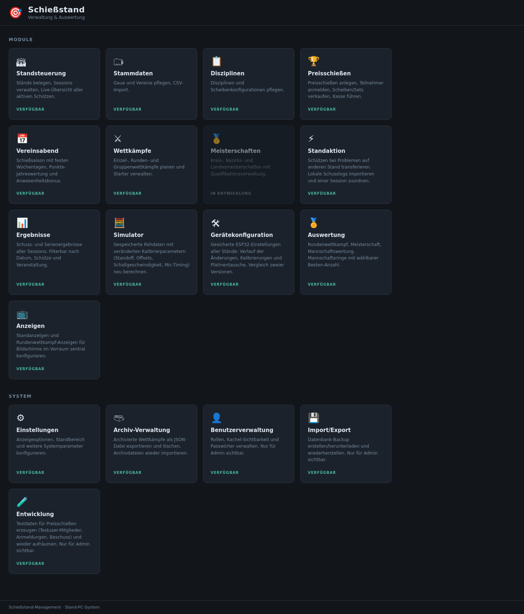

# 1. Systemüberblick

## Aufbau der Anlage

Die Anlage erfasst Treffer auf Luftgewehr- und Luftpistolenscheiben (10 m)
elektronisch und verwaltet alles rund um den Schießbetrieb: Mitglieder,
Disziplinen, Preisschießen, Vereinsabende, Wettkämpfe und Ergebnisse.

```
 Je Stand                              Zentral
┌───────────────────────────┐  HTTP   ┌──────────────────────────────┐
│ Kugelfang mit Mikrofonen  │ ◄─────► │ Server (:8090)               │ ◄── Browser
│   │ (USB oder TCP)        │         │  Verwaltung, PDF, Mail, Druck│     (Büro, Kasse,
│   ▼                       │         └──────────────┬───────────────┘      Aufsicht)
│ ESP32-Messplatine         │                        │ SQL
│   │                       │  SQL    ┌──────────────▼───────────────┐
│   ▼                       │ ──────► │ Datenbank (PostgreSQL)       │
│ Stand-PC (:900x)          │ (nur    └──────────────▲───────────────┘
│   ▲                       │ Schüsse)               │ SQL (nur lesen)
│   │ HTTP + SSE            │         ┌──────────────┴───────────────┐
│ Schützenanzeige           │         │ Preisanzeige (:8091)         │ ◄── Anzeige-
│ (Browser oder App)        │         └──────────────────────────────┘     Bildschirme
└───────────────────────────┘         Wertmaschine (:8092) ◄─HTTP─► Server; RS-232 zur Disag
```

| Baustein | Aufgabe |
|---|---|
| **Messplatine (ESP32)** | misst die Laufzeiten des Schalls an den Mikrofonen und berechnet daraus die Trefferlage |
| **Stand-PC** | berechnet aus der Trefferlage Ring, Zehntel und Teiler, zählt Probe- und Wertungsschüsse, speichert die Schüsse und zeigt dem Schützen Scheibe und Ergebnisse |
| **Server** | zentrale Verwaltung im Browser: Stände belegen, Stammdaten, Preisschießen, Vereinsabend, Wettkämpfe, Ergebnisse, Einstellungen |
| **Datenbank** | PostgreSQL; gemeinsamer Datenbestand von Server, Stand-PCs (Schüsse) und Preisanzeige |
| **Preisanzeige** | eigener Dienst für die Bildschirme: Live-Anzeigen der Stände und Wettkämpfe sowie Ergebnislisten |
| **Wertmaschine** | bindet eine Disag-Auswertemaschine für Papierscheiben an |
| **Apps** | Standanzeige als Android-App, Ergebnisübernahme in die App „My Shootings“ |

Wie die Bausteine im Einzelnen miteinander kommunizieren, beschreibt
[Kapitel 10](10-kommunikation.md).

## Startseite

Nach dem Aufruf des Servers im Browser erscheint die Startseite mit allen
Modulen als Kacheln. Welche Kacheln sichtbar und nutzbar sind, hängt von der
gewählten **Rolle** ab (siehe unten).



*Startseite in der Rolle „Admin“. Im unteren Bereich „System“ liegen die
Verwaltungsfunktionen.*

## Rollen und Rechte

Die Anlage arbeitet mit **Rollen** statt persönlichen Benutzerkonten. Unten
rechts auf jeder Seite steht die aktuelle Rolle; ein Klick darauf wechselt
sie. Eine Rolle kann durch ein gemeinsames Passwort geschützt sein. Das
Passwort gilt für die Browsersitzung und muss nach dem Schließen des Browsers
oder nach einer Stunde ohne Nutzung erneut eingegeben werden.

Fest eingebaut sind:

| Rolle | gedacht für |
|---|---|
| **Admin** | Vereinsverantwortliche: alle Kacheln, alle Rechte |
| **Entwickler** | Technik: Kalibrierung, Simulator, Diagnose |
| **Anwender** | Schießleitung/Aufsicht im täglichen Betrieb |
| **Revisor** | Prüfung, inkl. Ergebniskorrekturen |

Weitere Rollen lassen sich in der [Benutzerverwaltung](08-verwaltung.md#benutzerverwaltung)
anlegen. Dort wird je Rolle festgelegt, welche Kacheln sie sieht und ob sie
Ergebnisse korrigieren oder Preisschießen bearbeiten darf.
