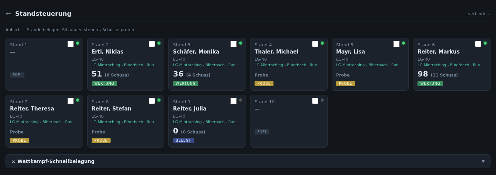
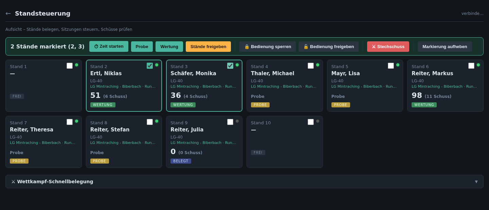
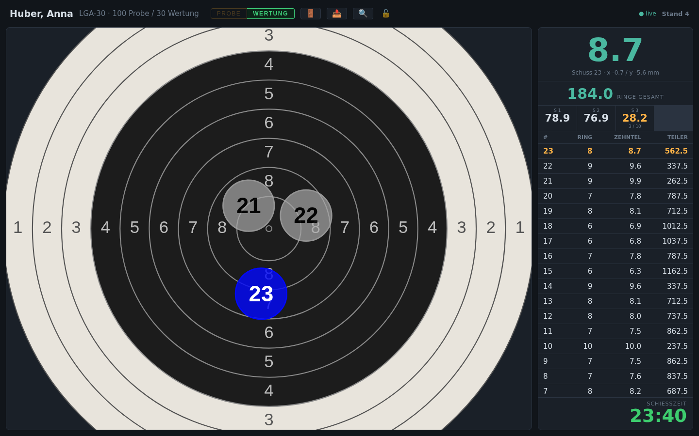
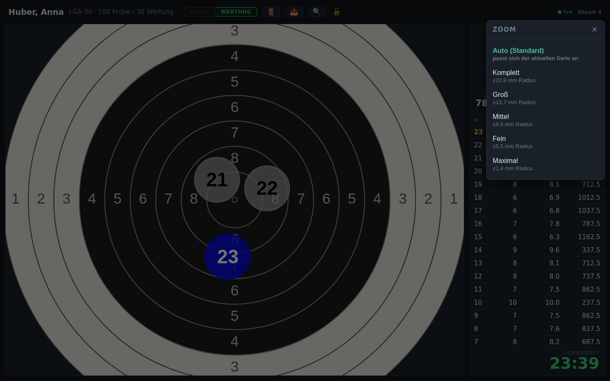
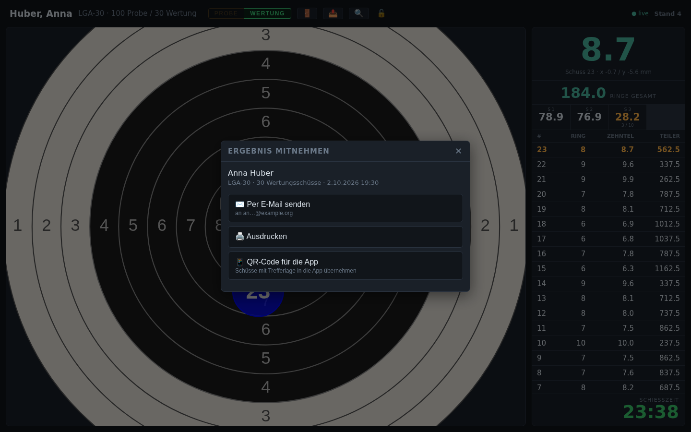
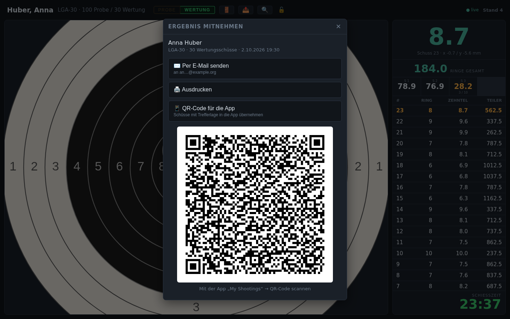
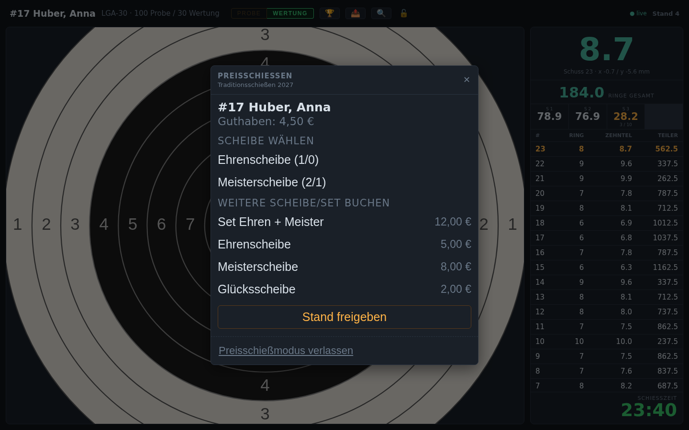
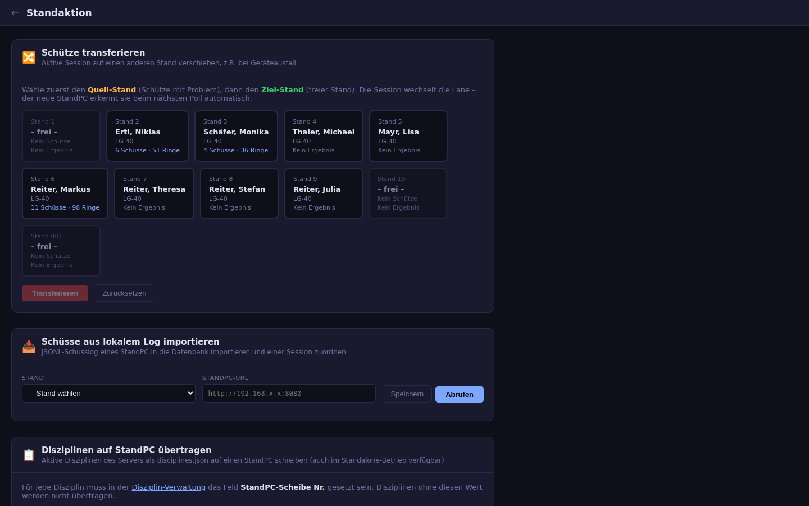

# 2. Standbetrieb

## Standsteuerung

Die Standsteuerung ist die Übersicht für die Aufsicht: Jeder Stand ist eine
Karte mit Schütze, Disziplin bzw. Scheibe, aktuellem Ergebnis und Status.
Der Punkt oben rechts zeigt, ob der Stand-PC erreichbar ist.

Funktionen:

- **Stand belegen:** Schütze (aus den Mitgliedern) und Disziplin wählen; der
  Stand-PC übernimmt die Belegung automatisch.
- **Sitzung steuern:** Probe/Wertung, Pause, Beenden bzw. Freigeben.
- **Live-Übersicht:** Ergebnisse und Schusszahlen aktualisieren sich laufend.
- **Preisschießen-Stände** werden gekennzeichnet (z. B. „wartet auf
  Teilnehmerwahl am Stand“ bei Selbstbedienung).
- **Wettkampf-Schnellbelegung:** Starter eines Wettkampfs direkt auf die
  Stände verteilen.
- **Wartungs-Schütze** (nur Admin): Stand ohne echten Schützen belegen, z. B.
  für Probeschüsse zur Kalibrierung. Diese Ergebnisse erscheinen nicht in der
  normalen Ergebnisliste.
- **Preisschießmodus beenden:** Ein Stand im Preisschießen (Selbstbedienung)
  lässt sich über seine Karte wieder freigeben; eine laufende Scheibe wird
  dabei beendet.

Ein Klick auf eine Karte öffnet die Detailansicht des Stands mit allen
Schüssen und den Knöpfen zum Steuern, darunter **⏱ Zeit starten** und
**🔒 Bedienung sperren** (siehe unten).

### Gemeinsame Standaktionen

Über das Kästchen oben rechts auf jeder Karte lassen sich Stände
**markieren**. Sobald mindestens ein Stand markiert ist, erscheint eine
Aktionsleiste, deren Aktionen für alle markierten Stände gleichzeitig gelten:

| Aktion | Wirkung |
|---|---|
| **⏱ Zeit starten** | Die Schießzeit läuft ab jetzt (siehe [Schießzeit](06-ergebnisse.md#schießzeit-und-umschalten-probe--wertung)) |
| **Probe / Wertung** | Stände in die Probe bzw. die Wertung schalten – beim zentralen Umschalten der einzige Weg |
| **Stände freigeben** | Sitzungen beenden; Stände im Preisschießmodus werden dabei aus der Selbstbedienung geholt |
| **🔒 Bedienung sperren / 🔓 freigeben** | Bedienung an der Schützenanzeige sperren bzw. wieder erlauben |
| **⚔ Stechschuss** | nächster Stechschuss einer unentschiedenen Paarung (genau zwei Stände markieren, siehe [Stechschüsse](06-ergebnisse.md#stechschüsse)) |

Gesperrte Stände tragen auf ihrer Karte ein 🔒 neben der Standnummer. Die
Sperre gehört zum Stand und bleibt auch beim Schützenwechsel bestehen, bis
sie aufgehoben wird.

Steht in einem laufenden Paarungswettkampf eine Paarung nach allen
Wertungsschüssen gleich, erscheint oben der Kasten **„Stechen
erforderlich“** mit den Ständen der beiden Schützen und den Knöpfen
**Stände markieren** und **Stechschuss n starten**.

## Anzeige am Stand

Am Stand sieht der Schütze seine Scheibe mit den Treffern der laufenden
Serie, den letzten Schuss groß, das Gesamtergebnis, die Serien und eine
Liste aller Schüsse. Die Anzeige läuft im Browser des Stand-PC oder als
[Android-App](09-apps.md#standanzeige-app).

*Kopfzeile: Name, Disziplin, Umschalter Probe | Wertung, Knöpfe für die
Menüs und das Schloss; rechts der Verbindungsstatus und die Standnummer.
Rechts unten läuft die Schießzeit.*

| Knopf | Funktion |
|---|---|
| **PROBE \| WERTUNG** | Umschalter: links immer Probe (orange), rechts immer Wertung (grün). Der aktive Modus ist fett mit gefülltem Hintergrund, der andere wird angetippt. Zurück zur Probe nur vor dem ersten Wertungsschuss; bei zentralem Umschalten nur über die Standsteuerung |
| 🏆 | Preisschießen-Menü (nur im Preisschießen) |
| 🚪 | Stand freigeben (beendet die Sitzung, Schüsse bleiben gespeichert) |
| 📤 | Ergebnis mitnehmen: E-Mail, Ausdruck, QR-Code |
| 🎯 | Disziplin wählen (nur ohne zugewiesenen Schützen) |
| 🔍 | Zoom |
| 🔓 / 🔒 | zeigt, ob die Bedienung möglich (offen) oder in der Standsteuerung gesperrt ist (zu) |

Ist die **Bedienung gesperrt**, bleibt nur der Zoom: Freigeben, Ergebnis
mitnehmen, Disziplin und Preisschießen-Menü sind ausgeblendet, der
Umschalter zeigt den Modus nur an. Der Stand-PC lehnt diese Aktionen auch
selbst ab.

Treffer werden farbig dargestellt (Zehner rot, Neuner gelb, sonst blau; die
vorherigen Schüsse der Serie grau), mit einem schmalen, deckenden Rand in der
Farbe des Schusses. Bei verdeckten Disziplinen zeigt die Anzeige keine Werte
bzw. kein Trefferbild.

### Schießzeit

Rechts unten zeigt die Anzeige die Schießzeit, je nach Einstellung des
Wettkampfs (siehe [Schießzeit](06-ergebnisse.md#schießzeit-und-umschalten-probe--wertung)):

- **Uhrzeit** (weiß): nur die aktuelle Uhrzeit.
- **Soft** (grün): Countdown ohne Wirkung; nach Ablauf läuft er negativ
  weiter („überschritten“).
- **Hard** (rot): Countdown; nach Ablauf steht „Zeit abgelaufen 00:00“, und
  jeder weitere Schuss wird als ungültig gespeichert.

Bei getrennten Zeiten steht dort erst „Probezeit“, dann „Wertungszeit“. Vor
dem Start erscheint die volle Zeit abgeblendet („nicht gestartet“ bzw. beim
zentralen Umschalten „warten auf Start“). Nicht gewertete Schüsse kündigt die
Anzeige mit einem Hinweis an.

### Stechschuss

Bei einem Stechschuss beginnt die Scheibe leer und zeigt nur diesen Schuss.
Der Umschalter zeigt „STECHSCHUSS n“, ein roter Hinweis nennt den Durchgang
und das unveränderte Gesamtergebnis der Wertung.

### Zoom

Im Modus **Auto** wählt die Anzeige selbst die kleinste Vergrößerung, in der
alle Schüsse der laufenden Serie zu sehen sind. Alternativ gibt es fünf feste
Stufen.

### Ergebnis mitnehmen

Über 📤 kann sich der Schütze das Ergebnis seiner letzten Scheibe auf diesem
Stand mitnehmen, auch nachdem der Stand schon freigegeben wurde (Ergebnisse
der letzten 12 Stunden).

- **Per E-Mail senden:** schickt das Einzelergebnis als PDF an die in den
  Stammdaten hinterlegte Adresse. Die Adresse wird am Stand nur gekürzt
  angezeigt. Voraussetzung: Mailserver in den
  [Einstellungen](08-verwaltung.md#einstellungen) eingerichtet.
- **Ausdrucken:** druckt das PDF auf dem in den Einstellungen gewählten
  Drucker.
- **QR-Code für die App:** zeigt einen QR-Code mit bis zu 60 Schüssen
  inklusive Trefferlage. Er wird mit der App „My Shootings“ gescannt (siehe
  [Apps](09-apps.md#app-my-shootings)).

Zum Schutz vor Missbrauch sind E-Mail und Druck auf drei Vorgänge je Ergebnis
in zehn Minuten begrenzt.

### Preisschießen am Stand

Läuft am Stand ein Preisschießen, öffnet sich das Menü automatisch, sobald
eine Auswahl ansteht. Der Teilnehmer wählt seine nächste Scheibe, kann
weitere Scheiben oder Sets buchen und den Stand freigeben. Ist ein Stand für
**Selbstbedienung** freigegeben, sucht sich der Teilnehmer zuerst selbst
über Nummer oder Namen aus.

*Die Zahlen hinter den Scheiben bedeuten gekauft/beendet.*

## Standaktion

Hilfsfunktionen für Störungen im laufenden Betrieb:

- **Schütze transferieren:** Eine laufende Sitzung auf einen anderen, freien
  Stand verschieben, z. B. bei einem Geräteausfall. Erst den Quell-Stand,
  dann den Ziel-Stand anklicken.
- **Schüsse aus lokalem Log importieren:** Jeder Stand-PC protokolliert alle
  Schüsse zusätzlich lokal. Fehlen Schüsse in der Datenbank (z. B. nach einer
  Netzwerkstörung), lassen sie sich von dort abrufen und einer Sitzung
  zuordnen.
- **Disziplinen auf Stand-PC übertragen:** Disziplinliste für den Betrieb
  ohne Serververbindung auf einen Stand-PC schreiben.

