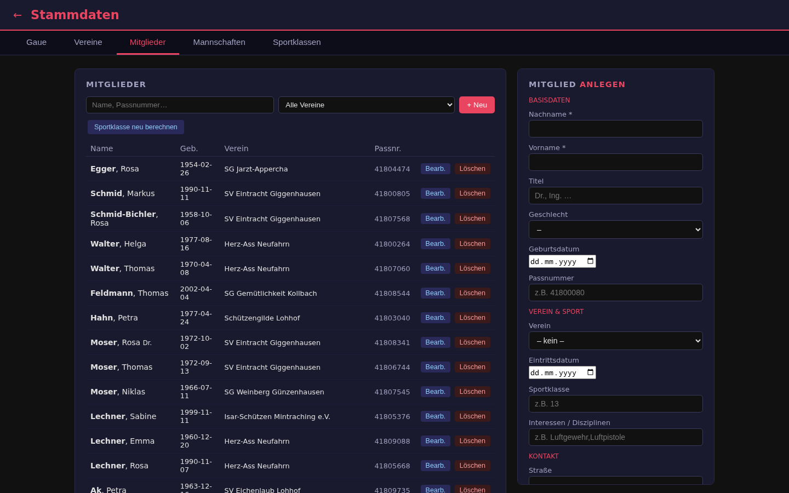
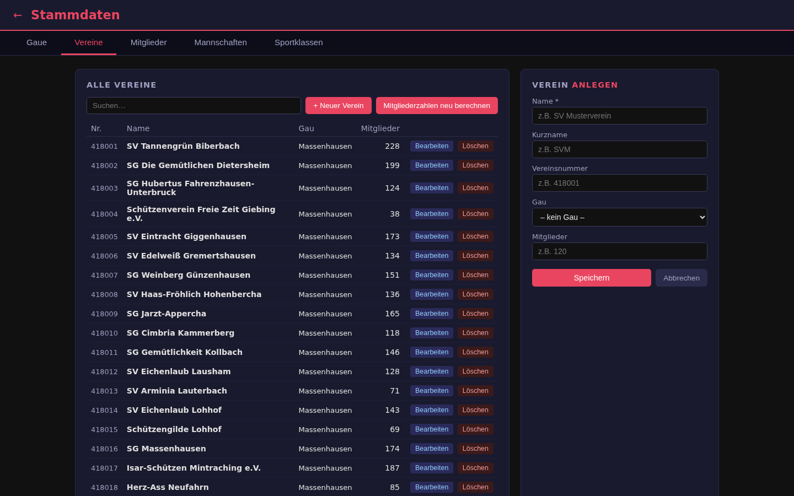
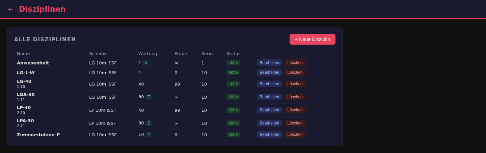

# 3. Stammdaten und Disziplinen

## Stammdaten

Die Stammdaten enthalten alle Personen und Organisationen, die die übrigen
Module verwenden. Die Seite hat fünf Reiter:

| Reiter | Inhalt |
|---|---|
| **Gaue** | Schützengaue (übergeordnete Verbände) |
| **Vereine** | Vereine mit Zuordnung zum Gau, CSV-Import |
| **Mitglieder** | Schützen mit Verein, Geburtsdatum, Passnummer, Sportklasse, Kontaktdaten (u. a. E-Mail für den Ergebnisversand), CSV-Import |
| **Mannschaften** | Mannschaften eines Vereins mit ihren Mitgliedern (für Wettkämpfe) |
| **Sportklassen** | Klassen wie Herren I, Damen II, Jugend; Zuordnung nach Alter |

*Mitgliederliste mit Suche nach Name oder Passnummer und Filter nach Verein;
rechts das Formular zum Anlegen. „Sportklasse neu berechnen“ ordnet alle
Mitglieder anhand des Geburtsdatums neu zu.*

## Disziplinen

Eine Disziplin legt fest, wie geschossen und gewertet wird.

Je Disziplin:

- **Scheibe** (z. B. LG 10 m ISSF, LP 10 m ISSF)
- **Wertungsschüsse** und **Probeschüsse** (∞ = unbegrenzt)
- **Schüsse je Serie**
- **Zehntelwertung** (Kennzeichen **Z**) oder ganze Ringe
- **Anzeige** am Stand: voll, teilverdeckt (Kennzeichen **TV**: keine Werte)
  oder verdeckt (Kennzeichen **V**: auch kein Trefferbild)
- **Papierscheibe** (Kennzeichen **P**): wird nicht elektronisch, sondern über
  die [Wertmaschine](07-technik.md#wertmaschine) ausgewertet
- aktiv/inaktiv
