# 4. Preisschießen

Das Modul Preisschießen bildet ein komplettes Preis- oder Traditionsschießen
ab: Teilnehmer anmelden, Scheiben und Sets verkaufen, Kasse führen, am Stand
schießen lassen, Wertungen berechnen und Gewinne zuordnen. Die
[Vereinsabend-Saison](05-vereinsabend.md) nutzt dieselbe Grundlage.

## Alle Preisschießen

Über „Liste“ (oben rechts) erreicht man alle Preisschießen und Saisons. Dort
werden neue angelegt; das aktuell bearbeitete wählt man oben rechts in der
Auswahlliste.

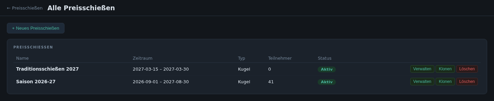

## Anmeldung

Mitglied über Nach- oder Vorname suchen oder direkt neu anlegen. Danach geht
es automatisch in der Kasse weiter.

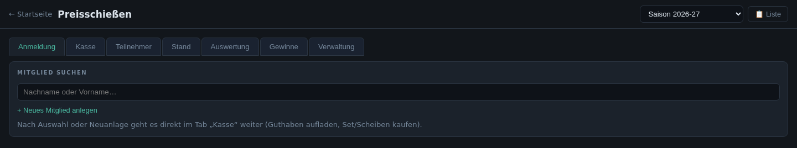

## Kasse

Die Kasse zeigt das Konto eines Teilnehmers: Guthaben, buchbare Sets und
einzelne Scheiben, den Warenkorb und alle bisherigen Käufe. Gekaufte, noch
nicht beschossene Scheiben können zurückgegeben werden. Über „Bezahlen“ wird
Guthaben aufgeladen bzw. ein Minus ausgeglichen.

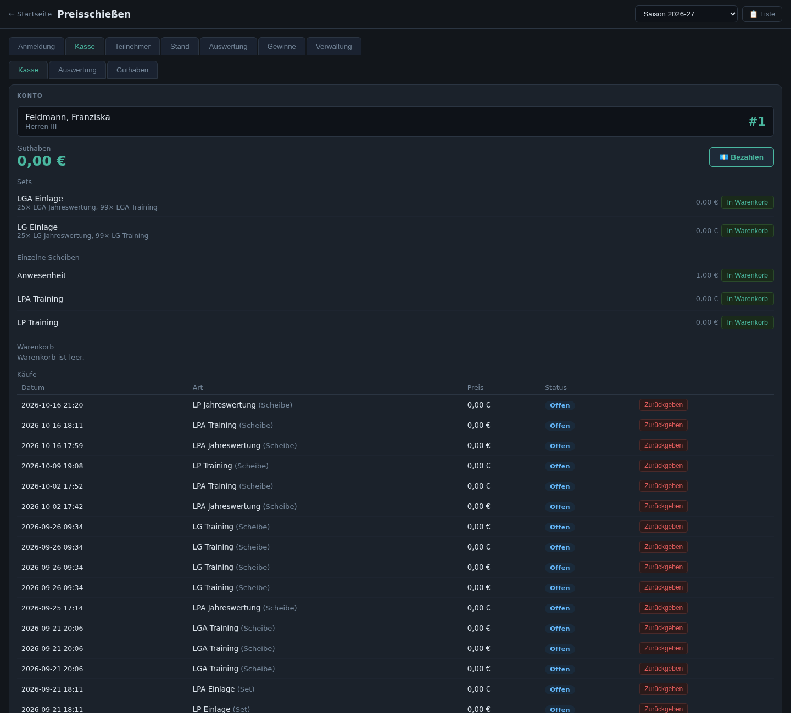

Unterreiter:

- **Auswertung:** Bareinnahmen und Verkäufe nach Scheiben-/Set-Typ für einen
  Zeitraum.
- **Guthaben:** Teilnehmer mit Guthaben im Minus bzw. im Plus.

## Teilnehmer

Alle Teilnehmer mit Nummer, Klasse, Guthaben und Anzahl Scheiben. Von hier
aus gelangt man direkt in die Kasse oder zur Standzuweisung.

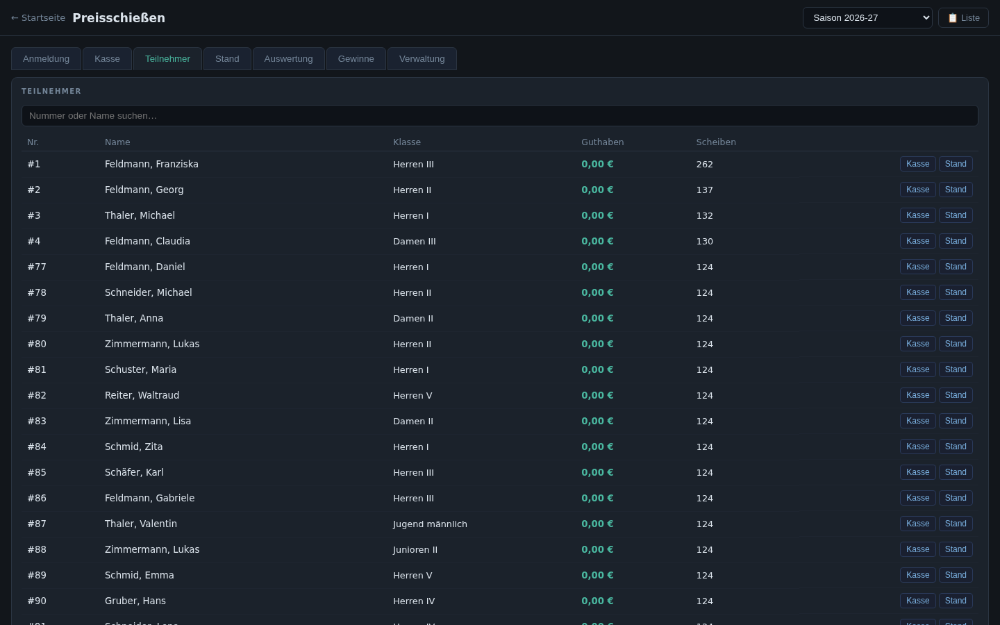

## Stand

Belegung der Stände für das Preisschießen: Teilnehmer einem Stand zuweisen,
Stände freigeben oder für **Selbstbedienung** öffnen. Bei Selbstbedienung
wählt sich der Teilnehmer am Stand selbst aus und sucht dort seine Scheibe
aus (siehe [Preisschießen am Stand](02-standbetrieb.md#preisschießen-am-stand)).

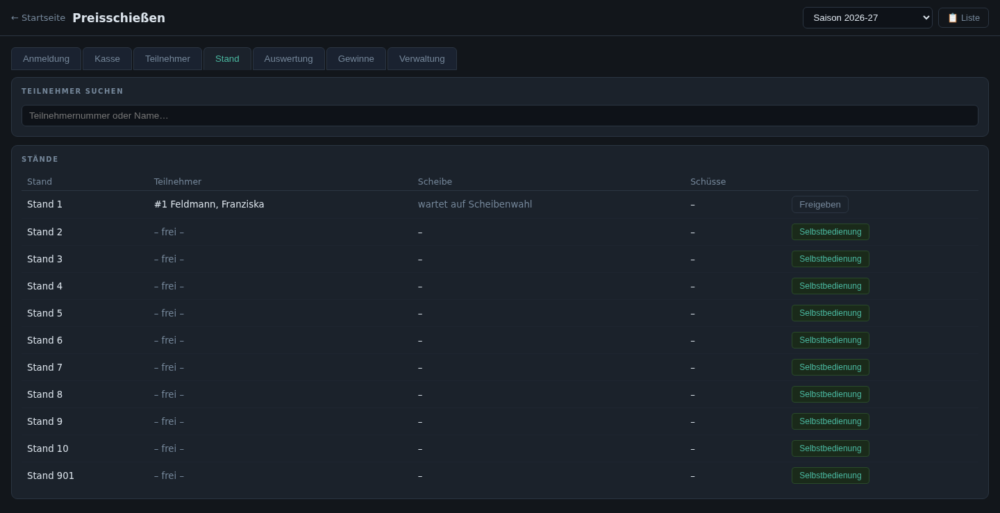

## Auswertung

### Wertungen

Eine Wertung legt fest, welche Scheiben wie zusammengezählt werden, z. B.
„Meister“ (beste Ringe) oder „Punkte-Saison“. Je Wertung einstellbar:

- **Typ** und **Wertungsfeld** (Ganzring, Zehntel, Teiler)
- **Serien:** alle einzeln, gesamt oder nur die ersten/besten N Serien
- **Scheiben mit Faktor:** gleicht unterschiedliche Scheiben aus (z. B. LG und
  LP in einer gemeinsamen Wertung)
- Einschränkung auf **Schützenklassen**
- Sichtbarkeit auf der Preisanzeige

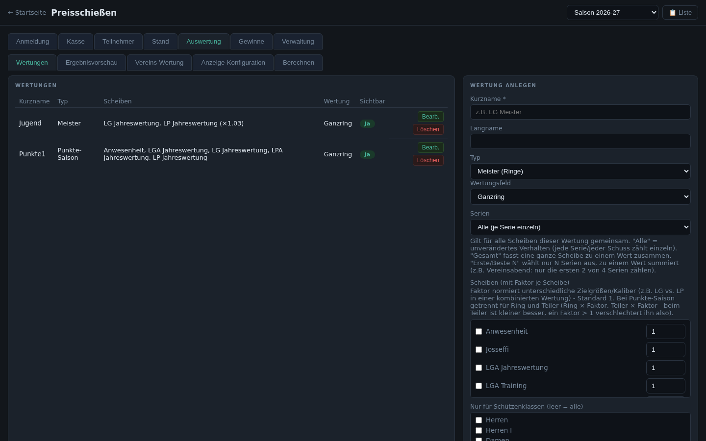

### Ergebnisvorschau und Vereins-Wertung

Die **Ergebnisvorschau** zeigt die berechneten Ranglisten aller Wertungen,
die **Vereins-Wertung** vergleicht die Vereine nach Teilnehmerzahl, Anteil
und Punkten. Beide lassen sich als CSV oder PDF exportieren.

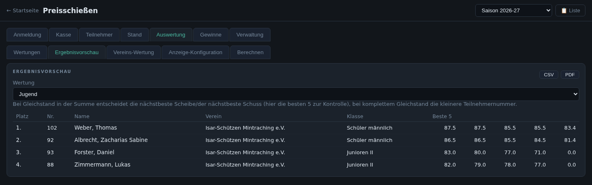

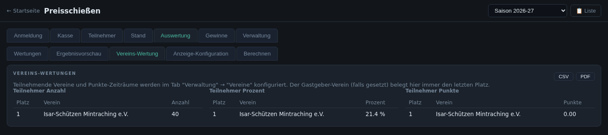

### Anzeige-Konfiguration und Berechnen

Unter **Anzeige-Konfiguration** wird festgelegt, welche Listen die
[Preisanzeige](06-ergebnisse.md#preisanzeige) auf den Bildschirmen zeigt.
**Berechnen** stößt die Neuberechnung aller Wertungen an (sie läuft
zusätzlich regelmäßig automatisch).

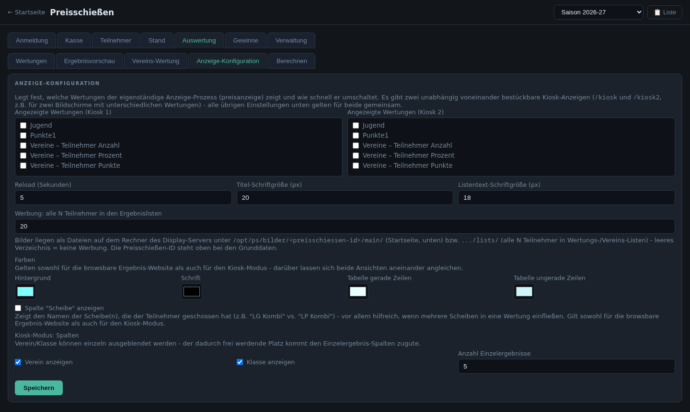

## Gewinne

Für jede Auswertungsliste werden die Preise je Platz hinterlegt.

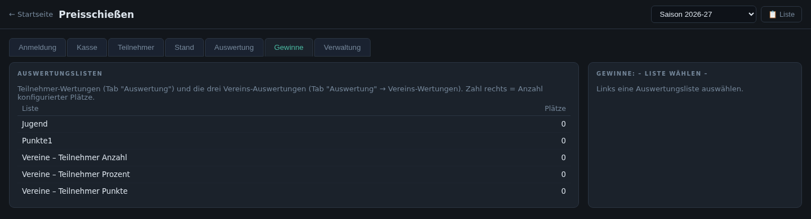

## Verwaltung

| Unterreiter | Inhalt |
|---|---|
| **Grunddaten** | Name, Zeitraum, Typ, erlaubtes Minus-Guthaben, aktiv/aktuell, Sets am Stand buchbar, Art (Preisschießen oder Vereinsabend-Saison, nachträglich änderbar) |
| **Scheiben** | buchbare Scheiben mit Disziplin, Preis, Zielscheibenfarbe, Höchstanzahl je Teilnehmer und Tag, Einschränkung auf Klassen und Vereine |
| **Sets** | Pakete aus mehreren Scheiben zu einem Gesamtpreis |
| **Vereine** | teilnehmende Vereine |

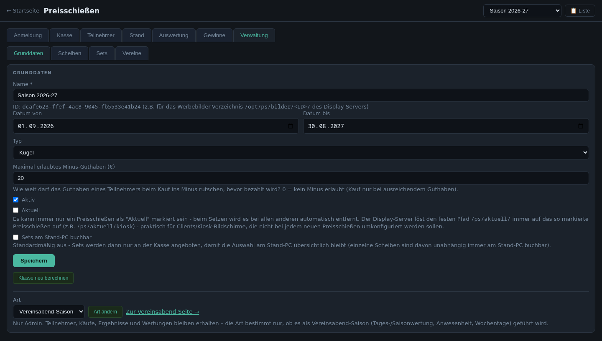

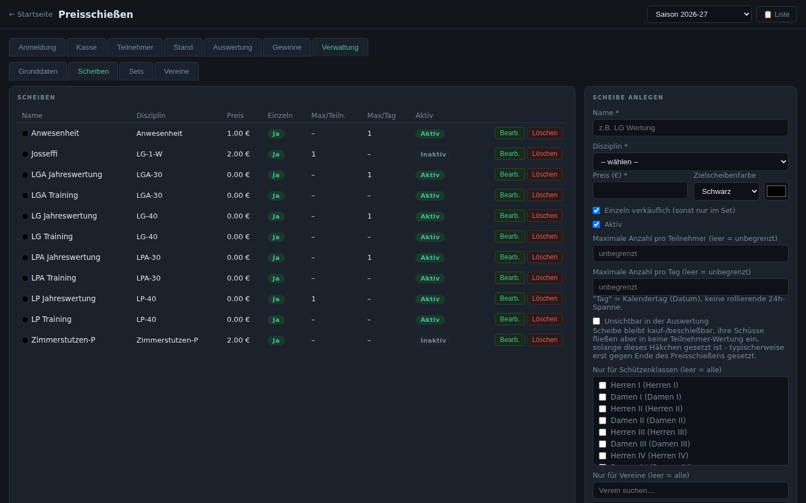
