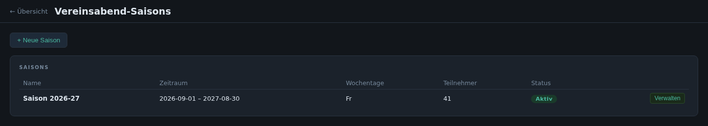
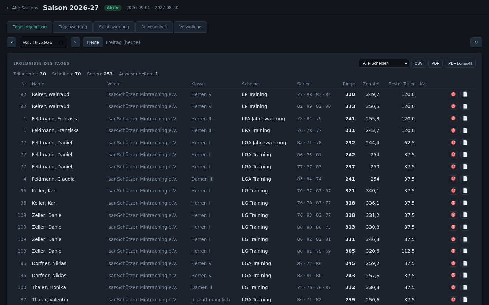
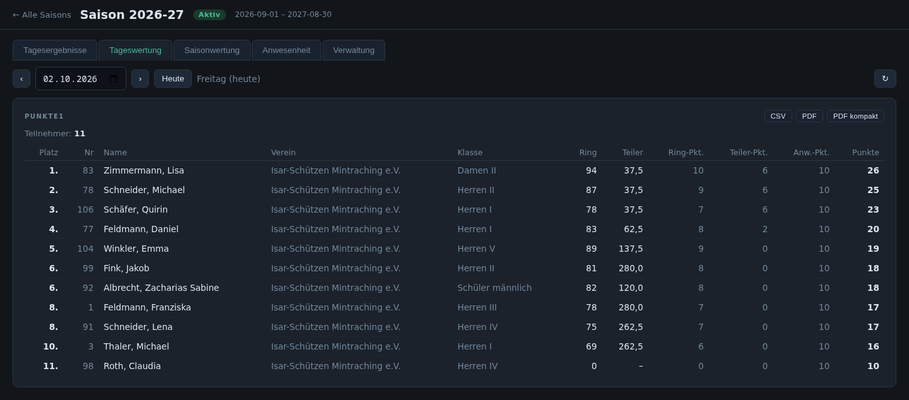
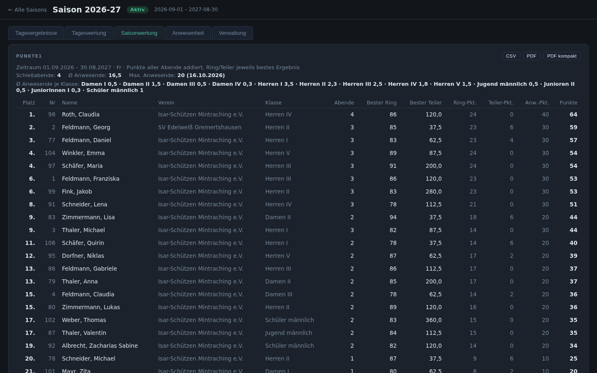
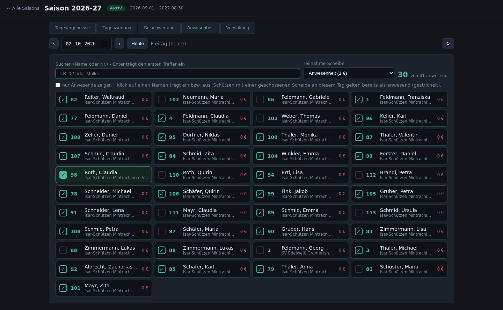
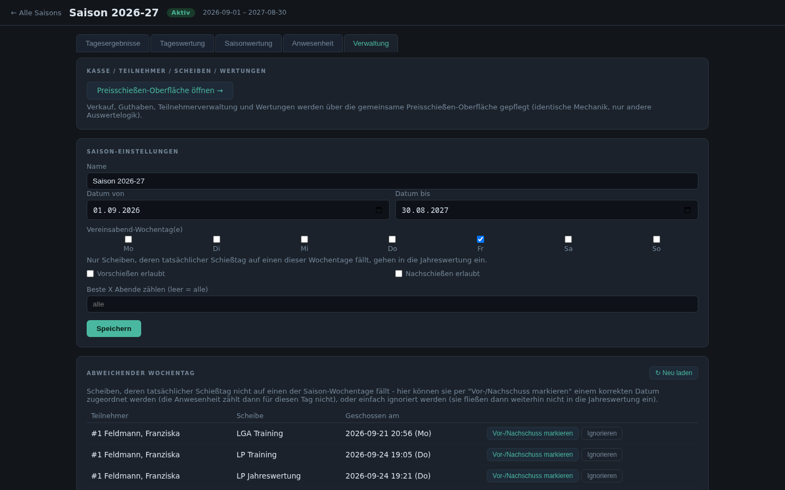

# 5. Vereinsabend

Eine **Vereinsabend-Saison** begleitet den regelmäßigen Schießabend des
Vereins über ein ganzes Jahr: an festen Wochentagen geschossene Scheiben
werden zu Tages- und Saisonwertungen zusammengefasst, die Anwesenheit wird
mitgezählt. Verkauf, Guthaben, Teilnehmer und Wertungen laufen über dieselbe
Oberfläche wie das [Preisschießen](04-preisschiessen.md).

## Saisons

Übersicht aller Saisons mit Zeitraum und Status. Von hier gelangt man in die
jeweilige Saison; neue Saisons werden über die Preisschießen-Liste mit der Art
„Vereinsabend-Saison“ angelegt.

## Tagesergebnisse

Alle Scheiben eines Schießabends mit Serien, Ringen, Zehnteln und bestem
Teiler. Mit den Pfeilen bzw. „Heute“ wechselt man den Tag. Je Zeile führen
Knöpfe zur grafischen Trefferansicht und zum PDF. Die Liste lässt sich nach
Scheibe filtern und als **CSV**, **PDF** oder **PDF kompakt** exportieren.

## Tageswertung

Die Wertungen des gewählten Abends mit Platzierung, z. B. eine
Punktewertung aus Ring-, Teiler- und Anwesenheitspunkten.

## Saisonwertung

Die Jahreswertung über alle Abende: Punkte werden addiert, je Teilnehmer
zählen bestes Ringergebnis und bester Teiler. Darüber stehen Kennzahlen wie
Anzahl der Schießabende und durchschnittliche Anwesenheit (auch je Klasse).
Spalten lassen sich durch Klick auf die Überschrift sortieren.

## Anwesenheit

Anwesenheit je Abend per Klick eintragen, auch für Mitglieder ohne
geschossene Scheibe. Wer an dem Tag eine Scheibe geschossen hat, gilt
automatisch als anwesend. Über die Teilnahme-Scheibe (z. B. „Anwesenheit
1 €“) wird die Anwesenheit gleichzeitig abgerechnet.

## Verwaltung

- **Saison-Einstellungen:** Name, Zeitraum, Vereinsabend-Wochentage, Vor-
  und Nachschießen erlaubt, Anzahl der Abende, die in die Jahreswertung
  zählen.
- **Abweichender Wochentag:** Scheiben, die an einem anderen Tag geschossen
  wurden, als Vor-/Nachschuss einem Abend zuordnen oder bewusst ignorieren.
- Link zur Preisschießen-Oberfläche für Kasse, Teilnehmer, Scheiben und
  Wertungen.

