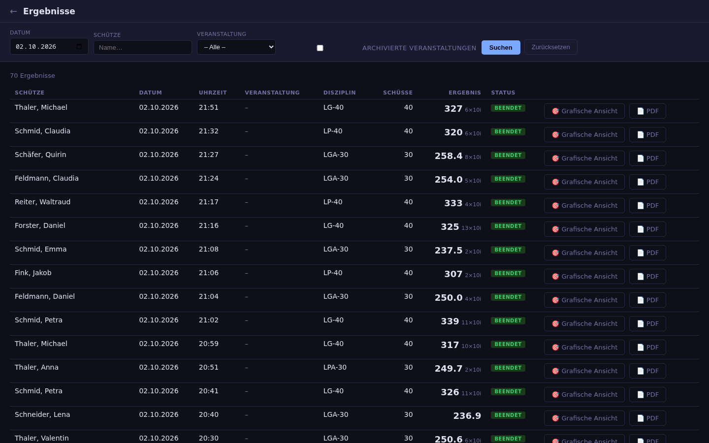
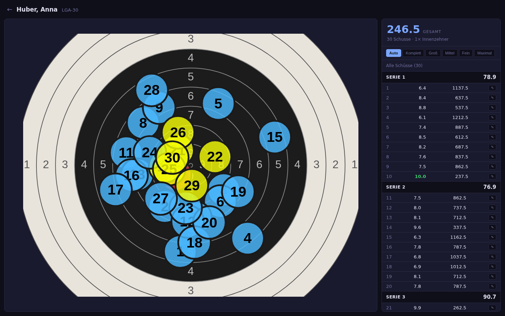
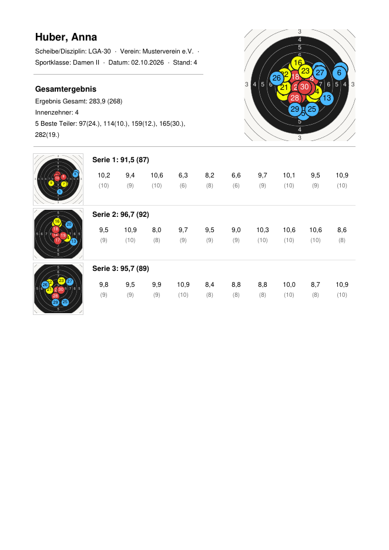
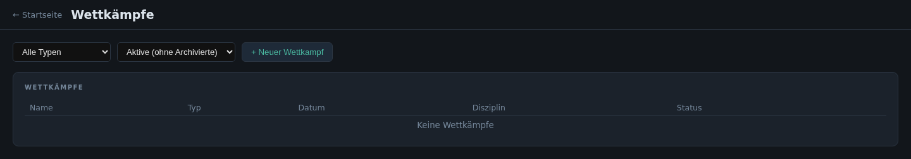
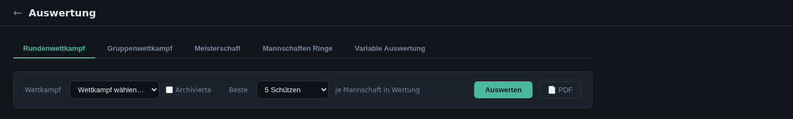
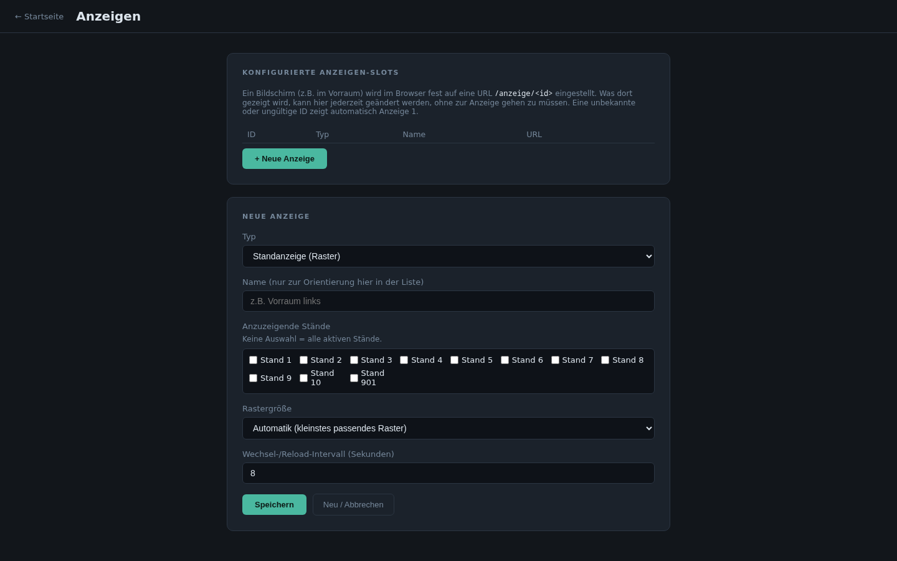
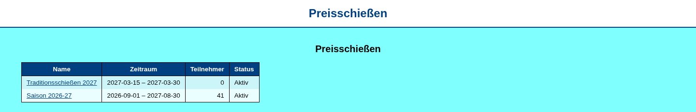
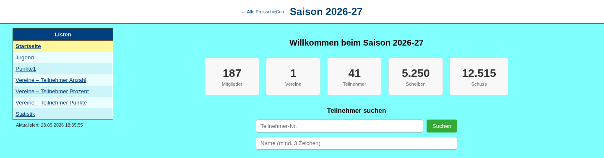
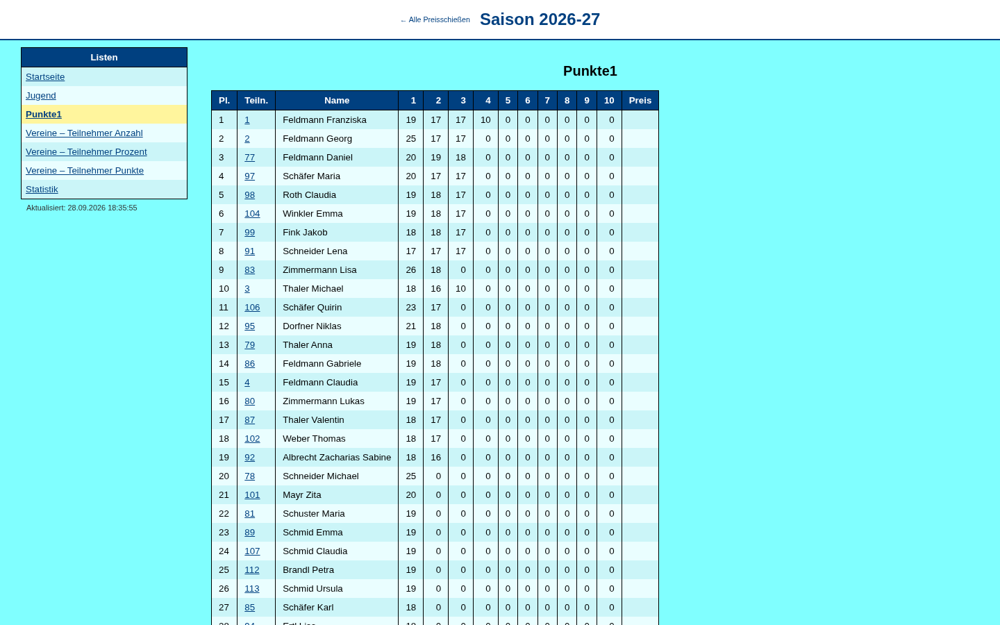

# 6. Ergebnisse, Wettkämpfe und Anzeigen

## Ergebnisse

Alle geschossenen Ergebnisse mit Schütze, Datum, Veranstaltung, Disziplin,
Schusszahl, Ergebnis (mit Anzahl Zehner) und Status. Filter nach Datum,
Name und Veranstaltung; archivierte Veranstaltungen lassen sich einblenden.
Je Ergebnis gibt es die **grafische Ansicht** und das **PDF**.

### Grafische Ansicht

Alle Treffer einer Scheibe auf der Zielscheibe, daneben jede Serie mit
Zehntelwert und Teiler je Schuss. Zoomstufen wie am Stand. Mit dem Recht
„Ergebnisse korrigieren“ lassen sich einzelne Schüsse nachträglich
korrigieren (✎); jede Korrektur wird protokolliert.

### Einzelergebnis als PDF

Das PDF fasst ein Ergebnis auf einer Seite zusammen: Kopf mit Name, Verein,
Sportklasse, Disziplin, Datum und Stand; Gesamtergebnis mit Innenzehnern
und den fünf besten Teilern; Trefferbild gesamt und je Serie mit
Ringbeschriftung. Unter jedem Schuss steht in Klammern der Wert der jeweils
anderen Wertungsart: bei Zehntelwertung der ganze Ring, bei Ringwertung der
Zehntelwert. Dasselbe PDF wird auch per E-Mail verschickt und am Stand
gedruckt.

## Wettkämpfe

Planung von Einzel-, Runden- und Gruppenwettkämpfen: Grunddaten,
teilnehmende Mannschaften und Einheiten, Starter. Ergebnisse können auch
manuell erfasst werden. Beendete Wettkämpfe
werden archiviert (siehe [Archiv](08-verwaltung.md#archiv)).

## Auswertung

Auswertungen von Wettkämpfen. Ergebnisse lassen sich als PDF ausgeben und
als „gespeicherte Auswertung“ ablegen:

| Reiter | Auswertung |
|---|---|
| **Rundenwettkampf** | Mannschaftswertung mit wählbarer Anzahl der besten Schützen je Mannschaft |
| **Gruppenwettkampf** | Gruppenwertung nach Ringen, Zehnteln oder Teiler, mit wählbarer Besten-Anzahl je Gruppe |
| **Meisterschaft** | Kreis-, Bezirks- und Landesmeisterschaften – *in Entwicklung* |
| **Mannschaften Ringe** | Direktvergleich der Mannschaftsringe über mehrere Veranstaltungen – *in Entwicklung* |
| **Variable Auswertung** | frei konfigurierbare Filter und Gruppierungen – *in Entwicklung* |

## Anzeigen

Bildschirme im Vorraum werden fest auf eine Adresse `/anzeige/<id>`
eingestellt. Was dort erscheint, wird hier zentral festgelegt, ohne an den
Bildschirm gehen zu müssen:

- **Standanzeige (Raster):** die Scheiben mehrerer Stände nebeneinander, live
- **Rundenwettkampf:** Zwischenstand eines Wettkampfs
- **Preisschießen (Kiosk):** Ergebnislisten eines Preisschießens (auch
  „automatisch das aktuell markierte“)

Einstellbar sind außerdem die angezeigten Stände, die Rastergröße und das
Wechselintervall.

## Preisanzeige

Die Preisanzeige ist ein eigener Dienst (Port 8091) für Ergebnislisten von
Preisschießen und Vereinsabenden auf Bildschirmen oder Tablets. Sie liest
nur bereits berechnete Ergebnisse und belastet den Server daher kaum.

Je Preisschießen gibt es eine Startseite mit Kennzahlen und
Teilnehmersuche sowie die in der Anzeige-Konfiguration freigegebenen Listen.

