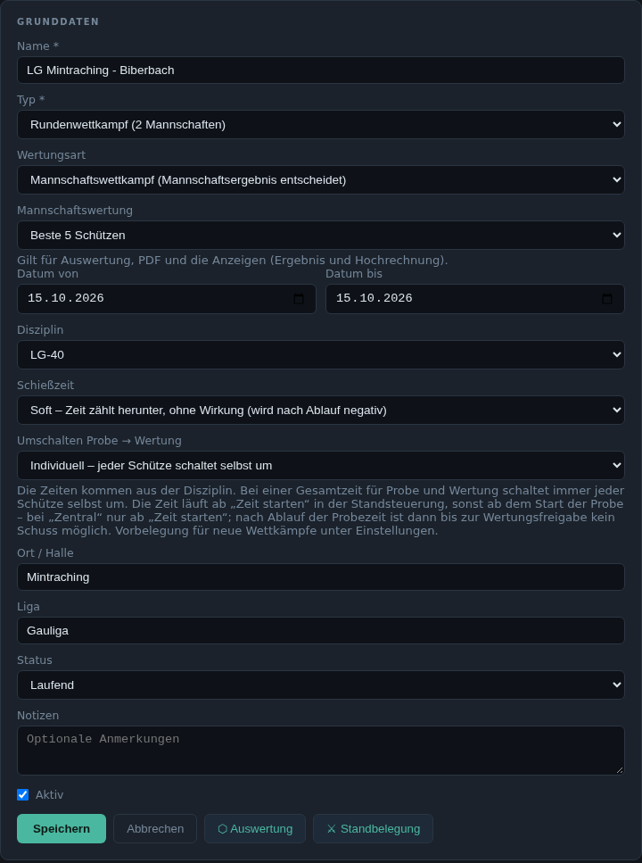
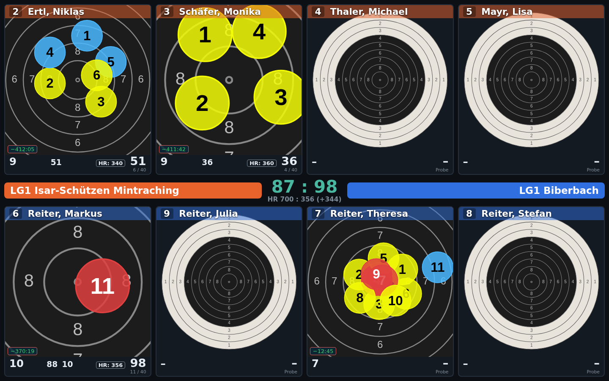
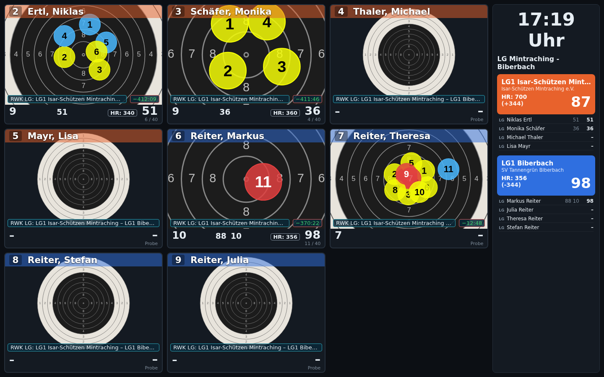

# 6. Ergebnisse, Wettkämpfe und Anzeigen

## Ergebnisse

Alle geschossenen Ergebnisse mit Schütze, Datum, Veranstaltung, Disziplin,
Schusszahl, Ergebnis (mit Anzahl Zehner) und Status. Filter nach Datum,
Name und Veranstaltung; archivierte Veranstaltungen lassen sich einblenden.
Je Ergebnis gibt es die **grafische Ansicht** und das **PDF**.

### Grafische Ansicht

Alle Treffer einer Scheibe auf der Zielscheibe, daneben jede Serie mit
Zehntelwert und Teiler je Schuss. Zoomstufen wie am Stand. Mit dem Recht
„Ergebnisse korrigieren“ lassen sich einzelne Schüsse nachträglich
korrigieren (✎); jede Korrektur wird protokolliert.

### Einzelergebnis als PDF

Das PDF fasst ein Ergebnis auf einer Seite zusammen: Kopf mit Name, Verein,
Sportklasse, Disziplin, Datum und Stand; Gesamtergebnis mit Innenzehnern
und den fünf besten Teilern; Trefferbild gesamt und je Serie mit
Ringbeschriftung. Unter jedem Schuss steht in Klammern der Wert der jeweils
anderen Wertungsart: bei Zehntelwertung der ganze Ring, bei Ringwertung der
Zehntelwert. Dasselbe PDF wird auch per E-Mail verschickt und am Stand
gedruckt.

## Wettkämpfe

Planung von Einzel-, Runden- und Gruppenwettkämpfen: Grunddaten,
teilnehmende Mannschaften und Einheiten, Starter. Ergebnisse können auch
manuell erfasst werden. Beendete Wettkämpfe
werden archiviert (siehe [Archiv](08-verwaltung.md#archiv)).

In den Grunddaten eines Wettkampfs werden neben Name, Typ, Datum, Disziplin
und Ort auch die Wertung und der Umgang mit der Schießzeit festgelegt:

### Rundenwettkampf

Ein Rundenwettkampf hat eine Heim- und eine Gastmannschaft. Nach dem
Festlegen der Mannschaften übernimmt **„Starter beider Mannschaften
übernehmen“** die Mitglieder beider Mannschaften als Starter. Je Starter
gibt es die Rolle **S** (Stammschütze), **E** (Ersatz, wird gewertet) oder
**AK** (außer Konkurrenz). Es gibt zwei Wertungsarten:

- **Mannschaftswettkampf:** Es entscheidet das Mannschaftsergebnis. Unter
  **Mannschaftswertung** wird festgelegt, wie viele Schützen je Mannschaft
  zählen (die besten 2 bis 10 oder alle). Diese Vorgabe gilt für die
  Auswertung, das PDF und die Anzeigen (Ergebnis und Hochrechnung).
- **Paarungswettkampf:** Je **Paarung** schießt ein Heim- gegen einen
  Gastschützen; das bessere Ergebnis (Zehntel bzw. Ringe) bringt der
  Mannschaft einen Punkt. Es gewinnt die Mannschaft mit den meisten Punkten.
  Bei vier Paarungen und Punktgleichstand zählt das Mannschaftsergebnis (Summe
  der gepaarten Schützen) als weiterer Punkt. Die Paarungen (1–5) werden je
  Starter zugeordnet, **„Automatisch zuordnen“** verteilt die Stammschützen
  der Reihe nach. Eine Übersicht zeigt, wer gegen wen schießt.

### Stechschüsse

Steht eine Paarung gleich, entscheiden einzelne Stechschüsse – je Paarung
ein eigener Durchgang an den beiden Ständen der Schützen. Gestartet wird
über die [Standsteuerung](02-standbetrieb.md#gemeinsame-standaktionen)
(beide Stände markieren → **⚔ Stechschuss** oder über den Kasten „Stechen
erforderlich“).

- Die ersten drei Stechschüsse zählen in der Wertung der Disziplin (Ringe
  oder Zehntel), ab dem vierten wird immer in Zehntel verglichen.
- Die Paarung ist entschieden, sobald in einem Durchgang ein Schütze besser
  ist; bei Gleichstand folgt der nächste Durchgang.
- Jeder Stechschuss beginnt am Stand mit leerer Scheibe; das Ergebnis der
  Wertung bleibt unverändert. Stechschüsse erscheinen nicht als eigenes
  Ergebnis in der Ergebnisliste.

### Schießzeit und Umschalten Probe → Wertung

Die Zeiten selbst stehen in der [Disziplin](03-stammdaten.md#disziplinen)
(Gesamtzeit oder getrennte Probe- und Wertungszeit). Im Wettkampf wird
festgelegt, wie sie wirken:

| Schießzeit | Wirkung |
|---|---|
| **Uhrzeit** | nur die Uhrzeit wird angezeigt (weiße Schrift) |
| **Soft** | Zeit zählt herunter, hat aber keine Wirkung (grüne Schrift); nach Ablauf wird sie negativ |
| **Hard** | Zeit zählt herunter; nach Ablauf wird kein Schuss mehr gewertet (rote Schrift) |

| Umschalten Probe → Wertung | Ablauf |
|---|---|
| **Individuell** | Jeder Schütze schaltet selbst um. Gilt immer, wenn die Disziplin nur eine Gesamtzeit hat. Die Wertungszeit beginnt mit dem Ende der Probezeit oder früher mit dem Umschalten. |
| **Zentral** | Zeitstart (**⏱ Zeit starten**) und Umschalten (**Wertung**) nur über die Standsteuerung; am Stand ist der Umschalter gesperrt. Vor dem Start und nach Ablauf der Probezeit bis zur Wertungsfreigabe wird kein Schuss gewertet. Die Wertungszeit beginnt mit der Freigabe. |
| **Automatisch** | Nach Ablauf der Probezeit schaltet der Stand selbst auf Wertung, falls der Schütze das nicht schon vorher getan hat. |

Die Zeit läuft ab **⏱ Zeit starten** in der Standsteuerung (einzeln oder für
alle markierten Stände), sonst ab dem Beginn der Probe. Die Vorbelegung für
neue Wettkämpfe steht in den [Einstellungen](08-verwaltung.md#einstellungen).

## Auswertung

Auswertungen von Wettkämpfen. Ergebnisse lassen sich als PDF ausgeben und
als „gespeicherte Auswertung“ ablegen:

| Reiter | Auswertung |
|---|---|
| **Rundenwettkampf** | Mannschaftswertung mit der im Wettkampf festgelegten Anzahl der besten Schützen (vorbelegt, für gespeicherte Auswertungen änderbar); beim Paarungswettkampf zusätzlich die Paarungswertung mit Punkten, Mannschaftspunkt, Stechschüssen und Endstand |
| **Gruppenwettkampf** | Gruppenwertung nach Ringen, Zehnteln oder Teiler, mit wählbarer Besten-Anzahl je Gruppe |
| **Meisterschaft** | Kreis-, Bezirks- und Landesmeisterschaften – *in Entwicklung* |
| **Mannschaften Ringe** | Direktvergleich der Mannschaftsringe über mehrere Veranstaltungen – *in Entwicklung* |
| **Variable Auswertung** | frei konfigurierbare Filter und Gruppierungen – *in Entwicklung* |

## Anzeigen

Bildschirme im Vorraum werden fest auf eine Adresse der
[Preisanzeige](#preisanzeige) eingestellt: `http://<Server>:8091/anzeige/<id>`.
Was dort erscheint, wird hier im Server zentral festgelegt, ohne an den
Bildschirm gehen zu müssen:

- **Standanzeige (Raster):** die Scheiben mehrerer Stände nebeneinander, live
- **Rundenwettkampf:** Zwischenstand eines Wettkampfs, wahlweise als
  **Liste** (Schützen mit Ergebnis) oder als **Scheiben** (je Mannschaft bis
  zu fünf Trefferbilder, in der Mitte Stand und Hochrechnung)
- **RWK-Dynamisch:** links alle belegten Stände als Trefferbilder (bei vielen
  Ständen seitenweise wechselnd), rechts die heute laufenden
  Rundenwettkämpfe mit Mannschaftsergebnis, Hochrechnung (HR) und den
  Einzelergebnissen, im Wechsel alle 10 Sekunden (einstellbar). Die Farben
  der Mannschaften (bis zu 5 Paarungen / 10 Mannschaften) sind einstellbar.
- **Preisschießen (Kiosk):** Ergebnislisten eines Preisschießens (auch
  „automatisch das aktuell markierte“)

Einstellbar sind außerdem die angezeigten Stände, die Rastergröße und das
Wechselintervall.

Die **Hochrechnung** rechnet den bisherigen Schnitt auf die volle
Schusszahl hoch; für die Mannschaft zählen die besten Schützen nach der im
Wettkampf festgelegten Wertung. Jedes Trefferbild zeigt außerdem die
Restzeit (Soft grün, Hard rot, siehe
[Schießzeit](#schießzeit-und-umschalten-probe--wertung)).

Im **Paarungswettkampf** stehen die Schützen einer Paarung in der
Scheibenansicht übereinander. Wer nach Hochrechnung vorne liegt, bekommt
oben rechts einen grünen Punkt, der andere einen grauen; in der Mitte stehen
die Punkte. Während eines Stechschusses zeigt das Trefferbild nur den
Stechschuss, Gesamtergebnis und Hochrechnung bleiben die der Wertung.

## Preisanzeige

Die Preisanzeige ist ein eigener Dienst (Port 8091) für die Bildschirme:
Ergebnislisten von Preisschießen und Vereinsabenden sowie die oben
beschriebenen Anzeigen (`/anzeige/<id>`). Sie liest die Datenbank nur und
rechnet keine Wertungen selbst: Preisschießen-Wertungen kommen aus dem vom
Server vorberechneten Ergebnis-Speicher, die Live-Anzeigen lesen die
aktuellen Schüsse direkt. Der Server wird dadurch nicht belastet (siehe
[Kommunikation](10-kommunikation.md)).

Je Preisschießen gibt es eine Startseite mit Kennzahlen und
Teilnehmersuche sowie die in der Anzeige-Konfiguration freigegebenen Listen.

