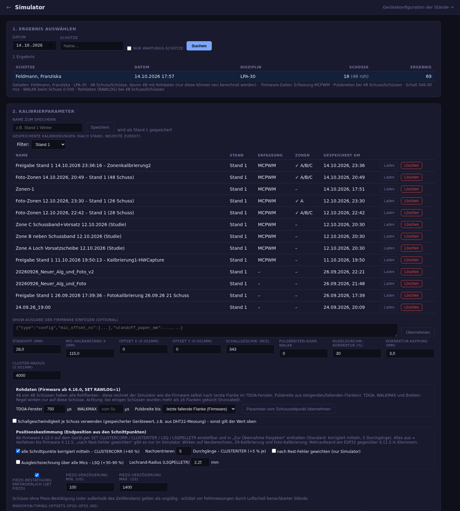
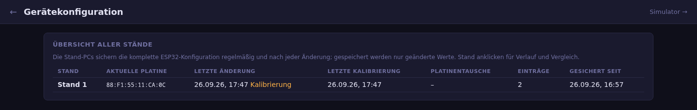
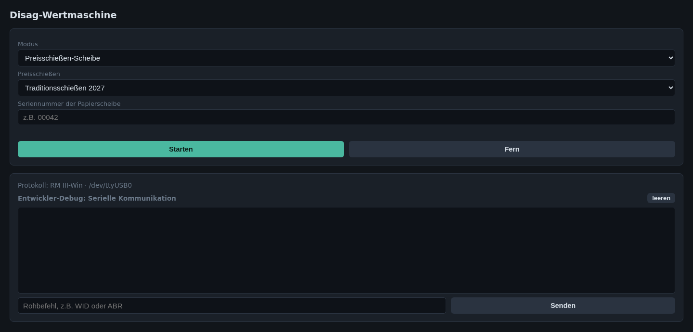

# 7. Technik und Kalibrierung

Diese Funktionen sind für die technische Betreuung der Anlage gedacht und
normalerweise nur in den Rollen Admin und Entwickler sichtbar.

## Simulator

Der Simulator berechnet gespeicherte Ergebnisse mit veränderten
Kalibrierparametern neu. Jeder Schuss wird mit seinen Rohdaten (Laufzeiten
an den Sensoren) gespeichert, deshalb lässt sich jede Einstellung im
Nachhinein an echten Schüssen ausprobieren, ohne erneut zu schießen.

Die Seite ist in sechs Abschnitte gegliedert; Gruppen lassen sich auf- und
zuklappen (der Zustand bleibt im Browser gespeichert), die Kopfzeile jeder
Gruppe zeigt die wichtigsten aktuellen Werte:

1. **Ergebnis auswählen** – nach Datum und Schütze suchen; Ergebnisse des
   Wartungs-Schützen lassen sich gezielt filtern.
2. **Parametersatz** – mit dem Erklärkasten „So hängen Parameter und
   Kalibrierungen zusammen“ und den Gruppen
   - *Gespeicherte Kalibrierungen laden* (nach Stand gefiltert, mit
     Erfassungsmodus und Zonen; SHOW-Ausgabe des Geräts übernehmen),
   - *Grundwerte* – gelten für jeden Treffer: Standoff, Mikrofon-Halbabstand,
     Schallgeschwindigkeit, Nachkorrektur OFFSETX/Y, Mikrofon-Offsets OFS0–OFS5,
   - *Zonen* – eigene Werte je Bereich der Scheibe (siehe unten),
   - *Auswerteverfahren* – Kugeldurchmesser-Korrektur (Standard 30 %),
     Cluster-Radius (Standard 4000 µm), Positionsbestimmung, Mikrofone, Piezo,
     Pulsbreiten-Korrektur, Rohdaten.
   **Neu berechnen** zeigt die Wirkung auf die Schüsse.
3. **Kalibrieren mit Foto (empfohlen)** – Foto markieren, One-Click-
   Kalibrierung, Einzelschritt „nur Grundwerte“, Messwerte gegen das Foto
   prüfen.
4. **Kalibrieren ohne Foto** – Rest-Fehler (wie CAL START) oder
   Schnittpunkt-Cluster Σ9.
5. **Speichern und an den Stand übertragen.**
6. **Ergebnis** – Original und Neuberechnung im direkten Vergleich, inklusive
   Qualitätsmaß (Streuung der Schnittpunkte) und – nach einer
   Foto-Kalibrierung – der Lage laut Foto je Schuss.

**Welche Werte wann gelten:** Ohne Zonen rechnet jeder Treffer mit den
Grundwerten. Mit Zonen bestimmen die Grundwerte zuerst die Lage; der Treffer
wird dann mit dem Satz seiner Zone neu gerechnet, dessen
Schallgeschwindigkeit, OFS0–OFS5 und OFFSETX/Y die Grundwerte ersetzen
(Geometrie und Auswerteverfahren gelten weiter). Nur die One-Click-
Kalibrierung bestimmt Grundwerte **und** Zonen; Rest-Fehler, Σ9 und der
Foto-Einzelschritt ändern nur die Grundwerte – sind Zonen eingeschaltet,
weist die Seite darauf hin, dass deren Sätze dann ggf. nicht mehr passen.

### Zonen-Kalibrierung

Der Knall eines Treffers klingt je nach getroffenen Papierlagen
unterschiedlich: im Loch der Vorsatzscheibe (nur das Schussband), neben dem
Schussband (nur die Vorsatzscheibe) oder auf beiden. Ein einziger
Parametersatz lässt deshalb je Bereich systematische Abweichungen. Die
**Zonen-Kalibrierung** verwendet je Bereich einen eigenen Satz aus
Schallgeschwindigkeit, Mikrofon-Offsets und Nachkorrektur:

| Zone | Bereich |
|---|---|
| **A** | im Loch der Vorsatzscheibe (LG Ø 30,5 mm, LP Ø 59,5 mm) |
| **B** | neben dem Schussband (Bandbreite ca. 90 mm) |
| **C** | Schussband und Vorsatzscheibe |

An den Zonengrenzen wird zwischen den Sätzen übergeblendet. Die Messplatine
rechnet identisch zum Simulator. Den Lochradius der Vorsatzscheibe setzt der
Stand-PC je Scheibe (LG/LP); der Simulator übernimmt ihn genauso aus der
Scheibe der geladenen Serie, auch beim Laden einer gespeicherten Kalibrierung.

### Foto-Kalibrierung

Grundlage ist ein Foto der beschossenen Papierscheibe. Der Maßstab kommt aus
dem Innenkreis der Scheibe, die Schrauben dienen nur zum Entzerren und
Ausrichten. Schusslöcher werden auch im schwarzen Bereich erkannt und lassen
sich von Hand ergänzen oder ausschließen.

**One-Click-Kalibrierung (Zonen):** ordnet die Löcher den Schüssen zu,
kalibriert den Basissatz an allen Schüssen und je Zone einen eigenen Satz,
trägt alles in Abschnitt 2 ein und speichert es als Kalibrierung
„Foto-Zonen …“. Ausreißer (mehr als 10 mm) werden dabei nicht verwendet.

### Übernahme an den Stand

Passt eine Einstellung, wird sie mit **Zur Übernahme freigeben** an einen
Stand geschickt (einschließlich der Zonen-Sätze). Der Stand-PC übernimmt sie
auf die Messplatine, sobald dort jemand die Übernahme bestätigt. In der
Admin-Oberfläche des Stand-PC kann statt der zuletzt freigegebenen auch jede
andere für diesen Stand gespeicherte Kalibrierung gewählt werden. Ist die
Anmeldung im Simulator abgelaufen, fragt die Seite das Passwort erneut ab,
ohne die Eingaben zu verlieren.

## Gerätekonfiguration

Die Stand-PCs sichern die komplette Konfiguration der Messplatinen regelmäßig
und nach jeder Änderung. Die Übersicht zeigt je Stand die aktuelle Platine,
die letzte Änderung und Kalibrierung sowie Platinentausche. Ein Klick auf
einen Stand öffnet den Verlauf; zwei Versionen lassen sich vergleichen (auf
Wunsch nur die Unterschiede).

## Admin-Oberfläche am Stand-PC

Jeder Stand-PC hat unter `/admin` eine eigene, passwortgeschützte
Oberfläche für Kalibrierung und Konfiguration direkt am Stand (mit
Live-Anzeige der Messwerte). Sie ist in die Reiter **Übersicht**,
**Kalibrierung**, **Konfiguration** und **Netzwerk** gegliedert; die
Einstellungen der Messplatine sind in aufklappbaren Gruppen geordnet,
die Zonen-Sätze werden angezeigt. Das Passwort wird zentral in den
[Einstellungen](08-verwaltung.md#einstellungen) gesetzt und an alle Stände
verteilt.

## Wertmaschine

Die Wertmaschine bindet eine Disag-Auswertemaschine (RM III) für
Papierscheiben an. Sie läuft auf dem Rechner, an dem die Maschine
angeschlossen ist, und überträgt die Ergebnisse an den Server, z. B. als
Preisschießen-Scheibe mit Seriennummer. Für die Fehlersuche zeigt sie die
serielle Kommunikation an.

