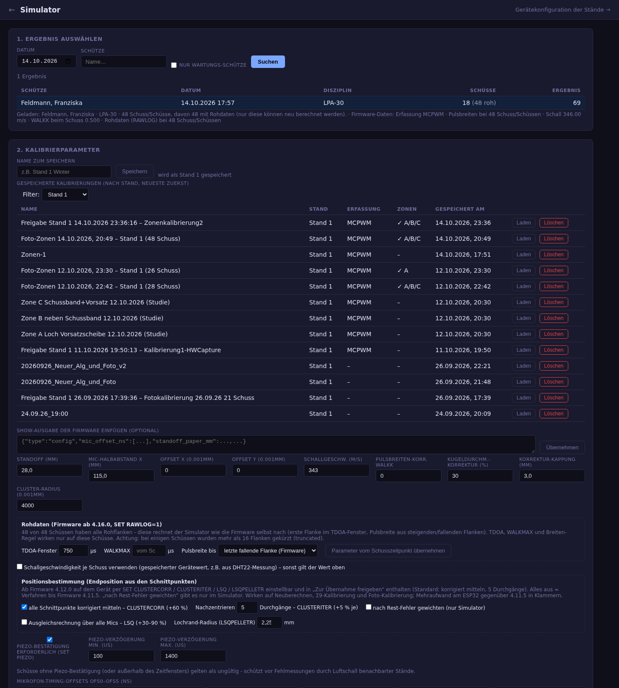
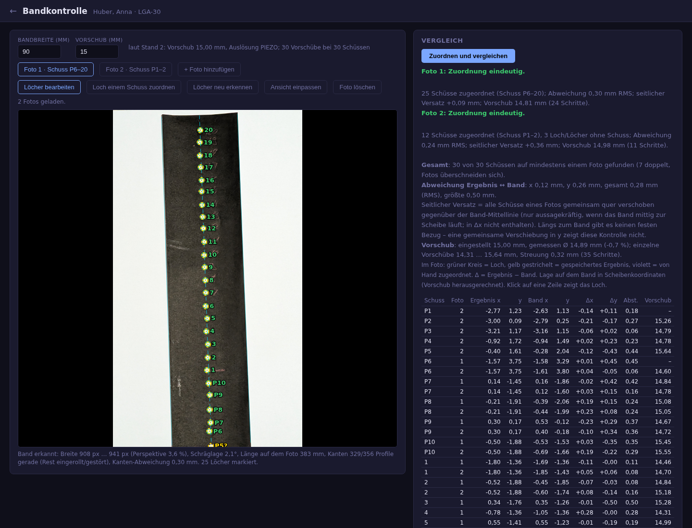
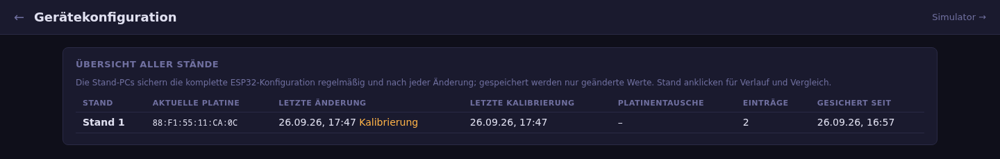
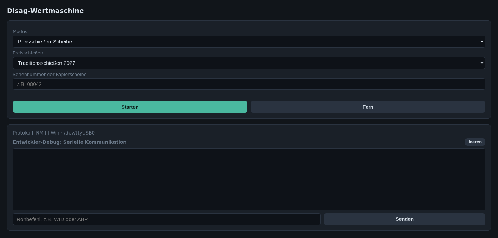

# 7. Technik und Kalibrierung

Diese Funktionen sind für die technische Betreuung der Anlage gedacht und
normalerweise nur in den Rollen Admin und Entwickler sichtbar.

## Simulator

Der Simulator berechnet gespeicherte Ergebnisse mit veränderten
Kalibrierparametern neu. Jeder Schuss wird mit seinen Rohdaten (Laufzeiten
an den Sensoren) gespeichert, deshalb lässt sich jede Einstellung im
Nachhinein an echten Schüssen ausprobieren, ohne erneut zu schießen.

Die Seite ist in sechs Abschnitte gegliedert; Gruppen lassen sich auf- und
zuklappen (der Zustand bleibt im Browser gespeichert), die Kopfzeile jeder
Gruppe zeigt die wichtigsten aktuellen Werte:

1. **Ergebnis auswählen** – nach Datum und Schütze suchen; Ergebnisse des
   Wartungs-Schützen lassen sich gezielt filtern.
2. **Parametersatz** – mit dem Erklärkasten „So hängen Parameter und
   Kalibrierungen zusammen“ und den Gruppen
   - *Gespeicherte Kalibrierungen laden* (nach Stand gefiltert, mit
     Erfassungsmodus und Zonen; SHOW-Ausgabe des Geräts übernehmen),
   - *Grundwerte* – gelten für jeden Treffer: Mikrofon-Anordnung (ab Firmware
     4.20 „schräg zur Mitte“, ältere Schüsse „flach“), Temperatur (daraus die
     Schallgeschwindigkeit), Nachkorrektur OFFSETX/Y, Entfernungskorrektur
     DIST0–DIST5 je Mikrofon,
   - *Zonen* – eigene Werte je Bereich der Scheibe (siehe unten),
   - *Auswerteverfahren* – Kugeldurchmesser-Korrektur (Standard 30 %),
     Cluster-Radius (Standard 4000 µm), Positionsbestimmung, Mikrofone, Piezo,
     Pulsbreiten-Korrektur, Rohdaten.
   **Neu berechnen** zeigt die Wirkung auf die Schüsse. In der
   Detailanzeige eines Schusses lassen sich die Schnittpunkte der
   Mikrofon-Kombinationen als **Rohwerte** oder **nach
   Kugeldurchmesser-Korrektur** zeigen. Die Rohwerte hängen nicht von der
   Kugeldurchmesser-Korrektur ab und bleiben bei einer Änderung gleich.
3. **Kalibrieren mit Foto (empfohlen)** – Foto markieren, One-Click-
   Kalibrierung, Einzelschritt „nur Grundwerte“, Messwerte gegen das Foto
   prüfen.
4. **Kalibrieren ohne Foto** – Rest-Fehler (wie CAL START) oder
   Schnittpunkt-Cluster Σ9.
5. **Speichern und an den Stand übertragen.**
6. **Ergebnis** – Original und Neuberechnung im direkten Vergleich, inklusive
   Qualitätsmaß (Streuung der Schnittpunkte) und – nach einer
   Foto-Kalibrierung – der Lage laut Foto je Schuss.

**Welche Werte wann gelten:** Ohne Zonen rechnet jeder Treffer mit den
Grundwerten. Mit Zonen bestimmen die Grundwerte zuerst die Lage; der Treffer
wird dann mit dem Satz seiner Zone neu gerechnet, dessen DIST0–DIST5 und
OFFSETX/Y die Grundwerte ersetzen (Anordnung, Temperatur und
Auswerteverfahren gelten weiter). Nur die One-Click-
Kalibrierung bestimmt Grundwerte **und** Zonen; Rest-Fehler, Σ9 und der
Foto-Einzelschritt ändern nur die Grundwerte – sind Zonen eingeschaltet,
weist die Seite darauf hin, dass deren Sätze dann ggf. nicht mehr passen.

### Mikrofon-Anordnung und Kalibrierwerte (ab Firmware 4.20)

Seit Firmware 4.20.0 stehen die Mikrofone schräg auf die Scheibenmitte
ausgerichtet; ihre Positionen (x/y/z je Mikrofon) sind fest in der Firmware
hinterlegt. Kalibriert wird je Mikrofon eine **Entfernungskorrektur**
(DIST0–DIST5, 0,001 mm, ±10 mm): sie verschiebt das Mikrofon entlang seiner
Linie zur Scheibenmitte. Die Schallgeschwindigkeit ergibt sich nur noch aus
der Temperatur (DHT22 oder Ersatztemperatur TEMP, Standard 20 °C =
343,2 m/s). Standoff, Mikrofon-Halbabstand, Timing-Offsets (OFS0–OFS5) und
die feste Schallgeschwindigkeit gibt es nicht mehr. Kalibrierungen und
Zonen-Sätze älterer Firmware passen nicht zur neuen Anordnung und müssen neu
bestimmt werden; der Stand-PC lehnt es ab, sie auf ein Gerät mit neuer
Firmware zurückzuspielen, ebenso eine Simulator-Freigabe für eine andere
Anordnung.

**Positionen der Mikrofone** (Anordnung „angled“, Stand der Vermessung vom
15.11.2026). Ursprung ist der Mittelpunkt der Papierscheibe, x nach rechts,
y nach oben, z vor der Scheibe Richtung Schütze (aus Schützensicht), Angaben
in mm. Die linke Seite ist angegeben, die rechte ist gespiegelt (x positiv).
Gemessen wurde die Vorderseite der Mikrofone; das eigentliche Messelement
liegt 3 mm weiter auf der Linie zum Scheibenmittelpunkt. Mit den Positionen
des Messelements rechnen Firmware und Simulator.

| Mikrofon | Vorderseite x / y / z | Abstand | Messelement x / y / z | Abstand | Neigung zur Scheibe | Richtung in der Ebene |
|---|---|---|---|---|---|---|
| oben (AIR2/AIR3) | −108,1 / +73,8 / 24,6 | 133,18 | −110,54 / +75,46 / 25,15 | 136,18 | 10,64° | 34,32° |
| mitte (AIR4/AIR5) | −111,4 / 0 / 25,1 | 114,19 | −114,33 / 0 / 25,76 | 117,19 | 12,70° | 0° |
| unten (AIR0/AIR1) | −108,1 / −73,8 / 24,6 | 133,18 | −110,54 / −75,46 / 25,15 | 136,18 | 10,64° | −34,32° |

*Neigung zur Scheibe*: Winkel der Linie Mikrofon → Scheibenmitte gegenüber
der Papierebene. *Richtung in der Ebene*: Winkel gegenüber der x-Achse, von
der Seitenwand aus gesehen.

Bis zu dieser Vermessung waren x = ∓109 / ∓113, y = ±75 / 0, z = 24 / 25
eingetragen (Abstand 134,47 / 115,73 mm). Die Messelemente liegen damit
1,71 mm (oben/unten) bzw. 1,46 mm (mitte) weiter vom Mittelpunkt entfernt
als bisher angenommen; quer zur Linie weichen sie 0,99 bzw. 0,45 mm ab.
Den Längsanteil hätte die Kalibrierung über DIST ausgeglichen, den
Queranteil nicht. Mit den korrigierten Positionen liegt DIST bei einem
korrekt aufgebauten Stand nahe 0 – größere Werte zeigen tatsächliche
Abweichungen beim Einbau (Distanzkontrolle). DIST-Werte, die mit den alten
Positionen kalibriert wurden, sind entsprechend um rund +1,5 bis +1,7 mm
verschoben und sollten neu kalibriert werden. Schüsse von Geräten, die noch
die alten Positionen melden, erkennt der Simulator weiterhin als „angled“
und rechnet sie mit den korrigierten Positionen nach.

### Zonen-Kalibrierung

Der Knall eines Treffers klingt je nach getroffenen Papierlagen
unterschiedlich: im Loch der Vorsatzscheibe (nur das Schussband), neben dem
Schussband (nur die Vorsatzscheibe) oder auf beiden. Ein einziger
Parametersatz lässt deshalb je Bereich systematische Abweichungen. Die
**Zonen-Kalibrierung** verwendet je Bereich einen eigenen Satz aus
Entfernungskorrekturen der Mikrofone und Nachkorrektur:

| Zone | Bereich |
|---|---|
| **A** | im Loch der Vorsatzscheibe (LG Ø 30,5 mm, LP Ø 59,5 mm) |
| **B** | neben dem Schussband (Bandbreite ca. 90 mm) |
| **C** | Schussband und Vorsatzscheibe |

An den Zonengrenzen wird zwischen den Sätzen übergeblendet. Die Messplatine
rechnet identisch zum Simulator. Den Lochradius der Vorsatzscheibe setzt der
Stand-PC je Scheibe (LG/LP); der Simulator übernimmt ihn genauso aus der
Scheibe der geladenen Serie, auch beim Laden einer gespeicherten Kalibrierung.

### Foto-Kalibrierung

Grundlage ist ein Foto der beschossenen Papierscheibe. Der Maßstab kommt aus
dem Innenkreis der Scheibe, die Schrauben dienen nur zum Entzerren und
Ausrichten. Schusslöcher werden auch im schwarzen Bereich erkannt und lassen
sich von Hand ergänzen oder ausschließen. Ein angeklicktes Loch rastet auf
die erkannte Lochmitte ein. Mit **Umschalt+Klick** wird es dagegen genau an
die angeklickte Stelle gesetzt, und ein schon markiertes Loch wird so dorthin
versetzt. Das hilft, wenn das Einrasten danebenliegt.

**One-Click-Kalibrierung (Zonen):** ordnet die Löcher den Schüssen zu,
kalibriert den Basissatz an allen Schüssen und je Zone einen eigenen Satz,
trägt alles in Abschnitt 2 ein und speichert es als Kalibrierung
„Foto-Zonen …“. Ausreißer (mehr als 10 mm) werden dabei nicht verwendet.

**One-Click ohne Zonen (nur Grundwerte):** wie oben, kalibriert aber nur den
Basissatz; die Zonen werden ausgeschaltet. Gespeichert wird die Kalibrierung
als „Foto …“.

### Übernahme an den Stand

Passt eine Einstellung, wird sie mit **Zur Übernahme freigeben** an einen
Stand geschickt (einschließlich der Zonen-Sätze). Der Stand-PC übernimmt sie
auf die Messplatine, sobald dort jemand die Übernahme bestätigt. In der
Admin-Oberfläche des Stand-PC kann statt der zuletzt freigegebenen auch jede
andere für diesen Stand gespeicherte Kalibrierung gewählt werden. Ist die
Anmeldung im Simulator abgelaufen, fragt die Seite das Passwort erneut ab,
ohne die Eingaben zu verlieren.

## Bandkontrolle

Die Bandkontrolle vergleicht die Löcher im Papierband mit dem gespeicherten
Ergebnis einer Scheibe. Sie wird in der grafischen Ansicht eines Ergebnisses
über **Bandkontrolle** geöffnet; dafür braucht die Rolle die Kachel
„Simulator“.

1. **Foto laden.** Das Band soll möglichst gerade und flach von oben
   fotografiert werden, auf hellem Untergrund. Das Foto wird zur Scheibe
   gespeichert. Für lange Bänder sind mit **+ Foto hinzufügen** bis zu
   10 Fotos je Scheibe möglich, z. B. Foto 1 mit Schuss 20–30 und Foto 2 mit
   Schuss 1–15. Die Fotos dürfen sich überschneiden oder Lücken lassen. Jedes
   Foto wird für sich ausgewertet; die Tabelle führt die Ergebnisse je Schuss
   zusammen. Ein Schuss, der auf zwei Fotos zu sehen ist, steht dort zweimal,
   mit der Nummer des Fotos.
2. **Band und Löcher prüfen.** Die Seite erkennt die Bandkanten. Daraus
   berechnet sie eine Mittellinie und den Maßstab aus der Bandbreite
   (Standard 90 mm). Eingerollte Enden werden dabei nicht berücksichtigt,
   und eine leichte Schräglage oder Perspektive wird herausgerechnet.
   Löcher werden automatisch erkannt; zwei sich überlappende Löcher werden
   geteilt. Ein Klick auf ein Loch entfernt es, ein Klick daneben fügt eines
   hinzu. Mit Umschalt+Klick wird es genau an die angeklickte Stelle gesetzt.
3. **Zuordnen und vergleichen.** Der Vorschub, der Vorschub-Auslöser
   (PAPERTRIGGER) und ob automatisch vorgeschoben wird (PAPERAUTO) kommen aus
   der gesicherten Gerätekonfiguration des Stands. Der Vorschub lässt sich
   überschreiben. Die Zuordnung probiert alle Lagen des Bandes auf dem Foto
   durch (gedreht, gespiegelt, Laufrichtung). Sie kommt auch mit Schüssen
   außer der Reihe zurecht, mit Schüssen, die nicht mehr auf dem Foto sind,
   mit fremden Löchern, etwa von der vorigen Scheibe, und mit zusätzlichen
   oder fehlenden Vorschüben, etwa durch einen Scheibenwechsel von Hand.

Ist die Zuordnung eines Fotos nicht eindeutig, meldet die Seite das. Das kommt vor allem
bei sehr engem Trefferbild vor, wenn das Band auf dem Foto an beiden Enden
abgeschnitten ist. Dann wird mit **Loch einem Schuss zuordnen** mindestens ein
Loch von Hand festgelegt (Wertung z. B. „12“, Probe z. B. „P3“).

Im Foto ist jedes Loch grün umrandet und mit seinem Schuss beschriftet. Die
Lage laut gespeichertem Ergebnis ist gelb gestrichelt eingezeichnet, von
Hand zugeordnete Löcher sind violett, Löcher ohne Schuss rot mit „?“.

Ergebnis ist eine Tabelle je Schuss mit der Lage laut Ergebnis und laut Band
(in Scheibenkoordinaten, Vorschub herausgerechnet), den Abweichungen Δx/Δy und
dem gemessenen Vorschub seit dem vorigen Schuss. Dazu kommt eine
Zusammenfassung:

- **Abweichung Ergebnis ↔ Band** (RMS und größte).
- **Gemeinsamer seitlicher Versatz** aller Schüsse gegenüber der
  Band-Mittellinie, je Foto. Er ist nur aussagekräftig, wenn das Band mittig
  zur Scheibe läuft. In Δx und der Abweichung ist er nicht enthalten, die
  Zuordnung funktioniert also auch bei einem Band, das nicht mittig läuft.
- **Vorschub**: eingestellt, gemessen und Streuung der einzelnen Vorschübe.
  Für eine Aussage braucht es mindestens 10 Vorschübe, besser 20.

Längs zum Band gibt es keinen festen Bezugspunkt. Eine gemeinsame
Verschiebung aller Schüsse in y lässt sich mit der Bandkontrolle deshalb nicht
erkennen.

Der Maßstab hängt an der Bandbreite. Ist das Band z. B. nur 89 mm breit,
erscheint der gemessene Vorschub um gut 1 % zu klein. Eine geplante Schablone
mit seitlichem Lineal soll den Maßstab künftig unabhängig davon liefern.

## Gerätekonfiguration

Die Stand-PCs sichern die komplette Konfiguration der Messplatinen regelmäßig
und nach jeder Änderung. Die Übersicht zeigt je Stand die aktuelle Platine,
die letzte Änderung und Kalibrierung sowie Platinentausche. Ein Klick auf
einen Stand öffnet den Verlauf; zwei Versionen lassen sich vergleichen (auf
Wunsch nur die Unterschiede).

## Admin-Oberfläche am Stand-PC

Jeder Stand-PC hat unter `/admin` eine eigene, passwortgeschützte
Oberfläche für Kalibrierung und Konfiguration direkt am Stand (mit
Live-Anzeige der Messwerte). Sie ist in die Reiter **Übersicht**,
**Kalibrierung**, **Konfiguration** und **Netzwerk** gegliedert; die
Einstellungen der Messplatine sind in aufklappbaren Gruppen geordnet,
die Zonen-Sätze werden angezeigt. Das Passwort wird zentral in den
[Einstellungen](08-verwaltung.md#einstellungen) gesetzt und an alle Stände
verteilt.

## Wertmaschine

Die Wertmaschine bindet eine Disag-Auswertemaschine (RM III) für
Papierscheiben an. Sie läuft auf dem Rechner, an dem die Maschine
angeschlossen ist, und überträgt die Ergebnisse an den Server, z. B. als
Preisschießen-Scheibe mit Seriennummer. Für die Fehlersuche zeigt sie die
serielle Kommunikation an.

