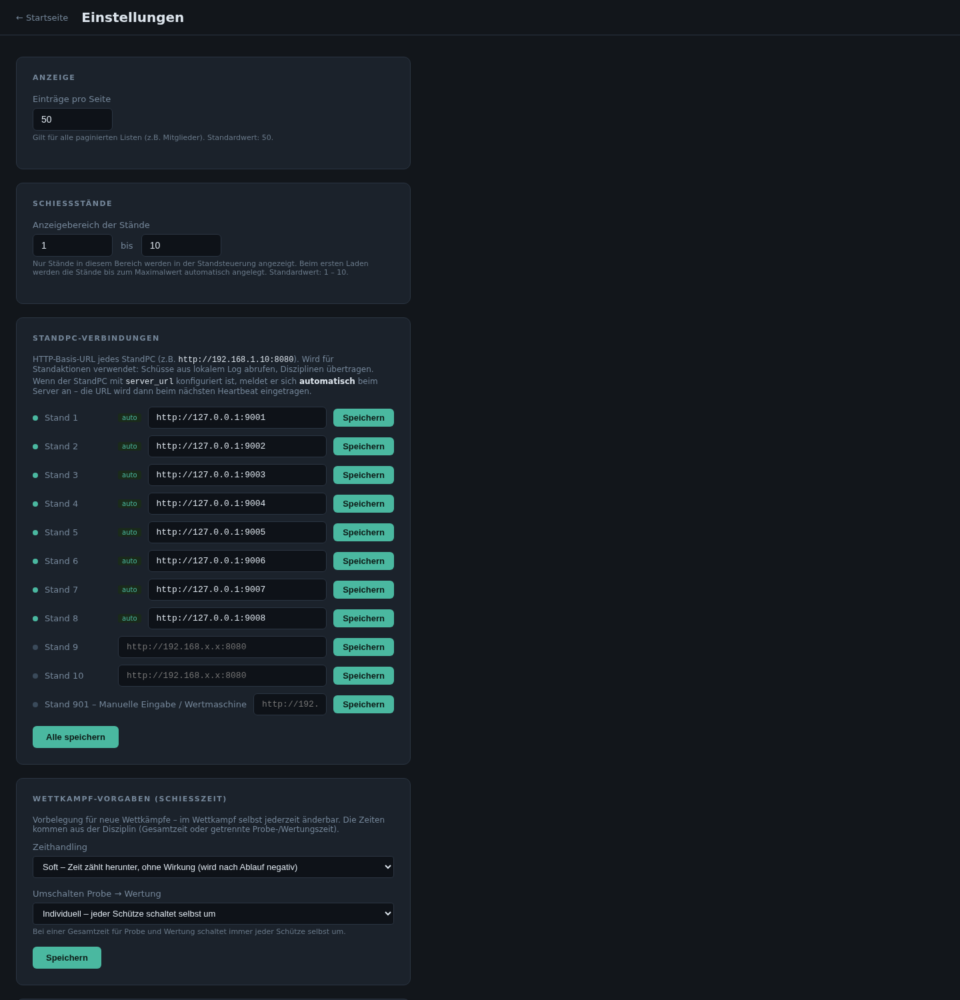
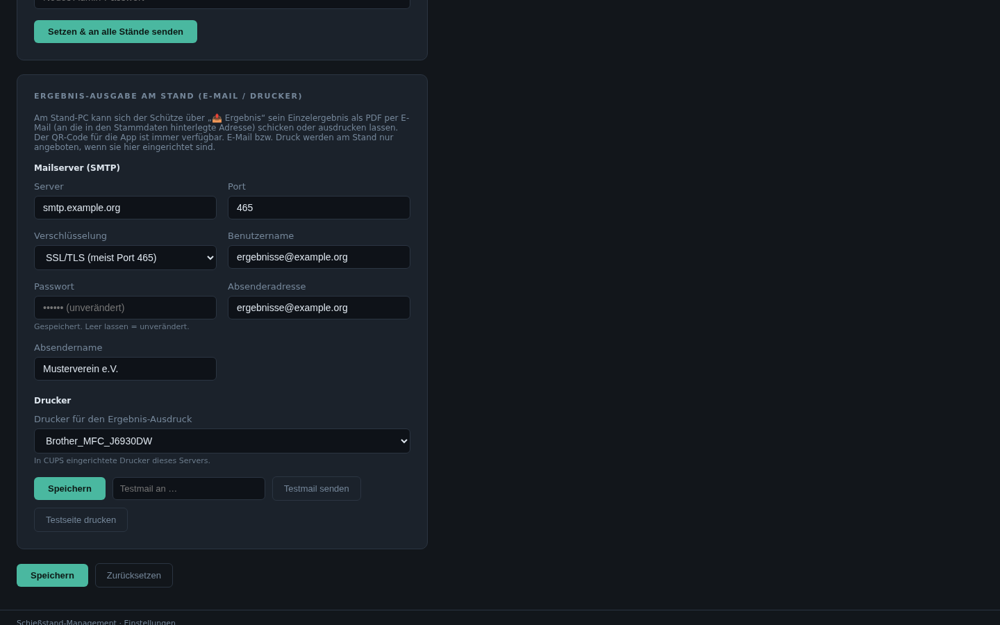
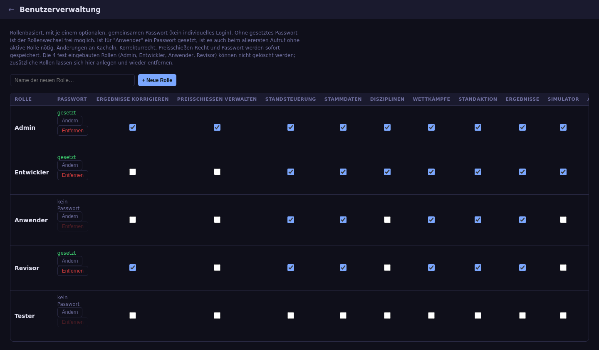
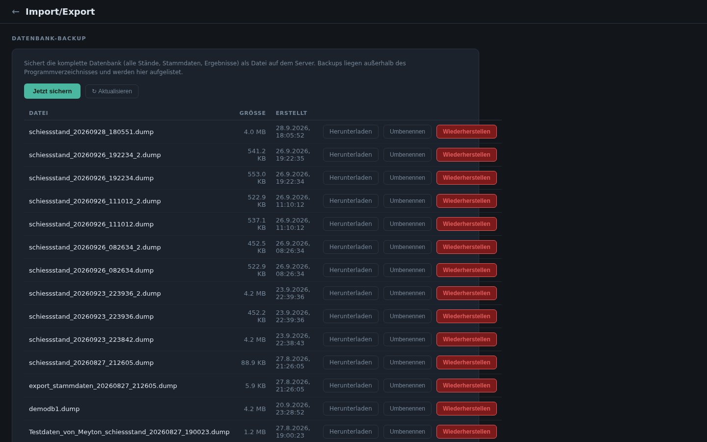
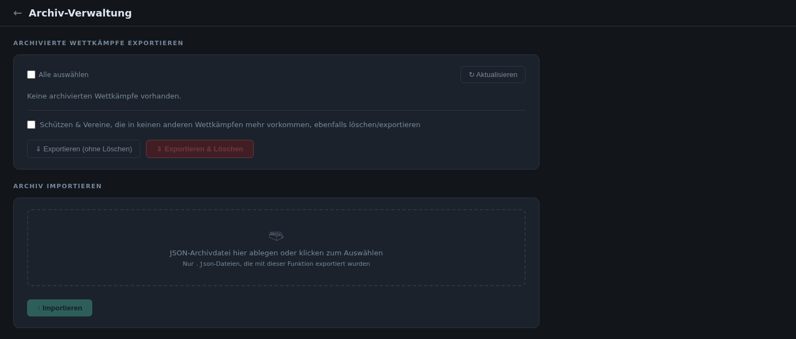
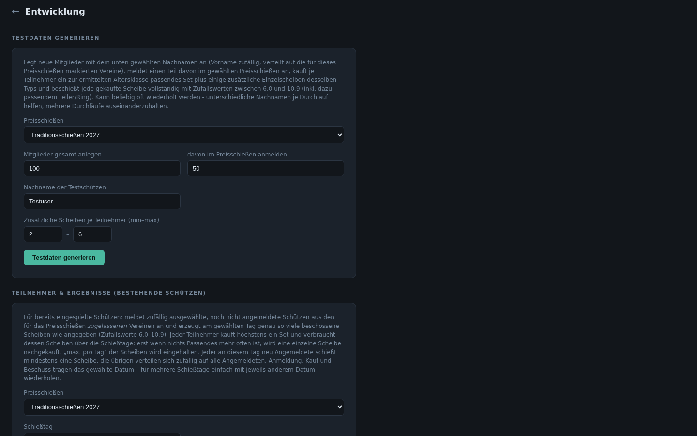

# 8. Systemverwaltung

## Einstellungen

Zentrale Einstellungen für die gesamte Anlage:

| Bereich | Inhalt |
|---|---|
| **Anzeige** | Einträge pro Seite in langen Listen |
| **Schießstände** | welche Standnummern in der Standsteuerung erscheinen |
| **StandPC-Verbindungen** | Adresse jedes Stand-PC (meldet sich normalerweise automatisch an) |
| **Online-Veröffentlichung (Internet)** | Adresse und API-Schlüssel des Online-Servers, Liste der übertragenen Preisschießen und Rundenwettkämpfe, siehe [Online-Anzeige](11-online.md) |
| **Wettkampf-Vorgaben (Schießzeit)** | Vorbelegung neuer Wettkämpfe: Zeithandling (Uhrzeit/Soft/Hard) und Umschalten Probe → Wertung (Individuell/Zentral/Automatisch), siehe [Schießzeit](06-ergebnisse.md#schießzeit-und-umschalten-probe--wertung) |
| **Entwicklermodus** | Schüsse per Mausklick auf die Scheibe auslösen (nur für Tests) |
| **Schriftgrößen (Stand-PC)** | Schriftgrößen der Standanzeige je Bereich, Versand an alle Stände |
| **Admin-Passwort (Stand-PC)** | Passwort für die Admin-Oberfläche der Stand-PCs, Versand an alle Stände |
| **Ergebnis-Ausgabe am Stand** | Mailserver und Drucker für „Ergebnis mitnehmen“ |

### Ergebnis-Ausgabe am Stand (E-Mail / Drucker)

Hier wird eingerichtet, was der Schütze am Stand über 📤 nutzen kann (siehe
[Ergebnis mitnehmen](02-standbetrieb.md#ergebnis-mitnehmen)):

- **Mailserver (SMTP):** Server, Port, Verschlüsselung (STARTTLS, SSL/TLS
  oder keine), Benutzername, Passwort, Absenderadresse und -name. Das
  Passwort wird nie angezeigt; ein leeres Feld lässt es unverändert.
- **Drucker:** Auswahl aus den auf dem Server eingerichteten Druckern (CUPS).
- **Testmail senden** und **Testseite drucken** prüfen die Einrichtung.

E-Mail und Druck werden am Stand nur angeboten, wenn sie hier eingerichtet
sind. Der QR-Code für die App ist immer verfügbar.

*Server, Benutzer und Absender sind im Bild Beispielwerte.*

## Benutzerverwaltung

Nur für Admin. Je Rolle wird festgelegt:

- **Passwort** (optional, gemeinsam für alle, die die Rolle nutzen)
- Sonderrechte **Ergebnisse korrigieren** und **Preisschießen verwalten**
  (anlegen, bearbeiten, löschen)
- sichtbare **Kacheln** der Startseite

Die vier eingebauten Rollen lassen sich nicht löschen; weitere Rollen können
angelegt und wieder entfernt werden.

## Import/Export

Nur für Admin. Datensicherung und Datenpflege:

- **Datenbank-Backup:** komplette Sicherung als Datei auf dem Server
  erstellen, herunterladen, umbenennen und wiederherstellen.
- **Selektiver Export/Import:** nur ausgewählte Bereiche (z. B. Stammdaten)
  übertragen.
- **Daten löschen:** gezielt Bereiche leeren.
- **Auf Werkszustand zurücksetzen:** Anlage in den Auslieferungszustand
  bringen.
- **Wiederherstellung von Datei:** eine heruntergeladene Sicherung wieder
  einspielen.

## Archiv

Archivierte Wettkämpfe als JSON-Datei exportieren und dabei auf Wunsch aus
der Datenbank löschen (optional auch nicht mehr benötigte Schützen und
Vereine). Archivdateien lassen sich später wieder importieren.

## Entwicklung

Nur für Admin; dient dem Testen. Erzeugt Testdaten für Preisschießen:

- **Testdaten generieren:** neue Test-Mitglieder anlegen, anmelden, Sets und
  Scheiben kaufen und mit Zufallswerten beschießen.
- **Teilnehmer & Ergebnisse (bestehende Schützen):** vorhandene Mitglieder
  für einen bestimmten Schießtag anmelden und beschießen.
- **Testdaten löschen:** alle erzeugten Testdaten wieder entfernen.

