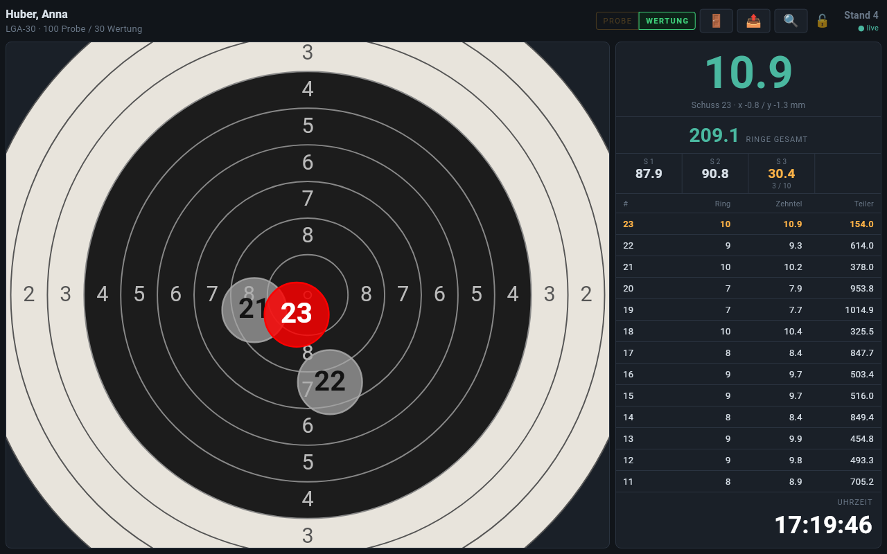
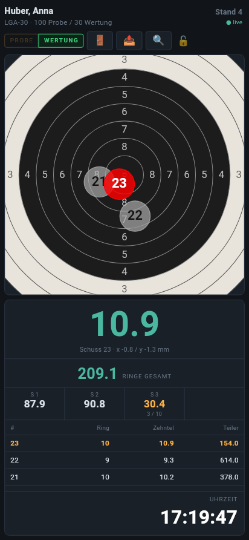
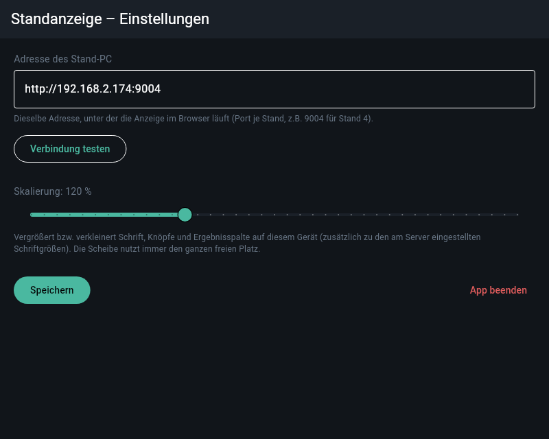

# 9. Apps

## Standanzeige-App

Die Standanzeige gibt es zusätzlich als Android-App für Tablets und Handys.
Sie zeigt dasselbe wie die Anzeige im Browser des Stand-PC (siehe
[Anzeige am Stand](02-standbetrieb.md#anzeige-am-stand)), ist aber auf den
Dauerbetrieb am Stand ausgelegt:

- **Vollbild** ohne Status- und Navigationsleiste; der Bildschirm bleibt an.
- **Stabile Verbindung:** Die App überwacht die Live-Verbindung zum Stand-PC
  selbst, baut sie bei Störungen neu auf und gleicht ihren Stand regelmäßig
  ab. Probleme mit dem Neuladen in manchen Browsern entfallen.
- **Quer- und Hochformat:** im Querformat Scheibe links und Ergebnisse
  rechts, im Hochformat Scheibe oben und Ergebnisse darunter.
- Alle Menüs wie im Browser: Umschalter Probe | Wertung, Preisschießen,
  Stand freigeben (🚪), Ergebnis mitnehmen, Disziplin, Zoom, dazu das Schloss
  für die gesperrte Bedienung, die Schießzeit rechts unten und die Anzeige
  des Stechschusses. Den Testmodus (Schuss per Klick) gibt es in der App
  nicht.

### Einrichtung

Beim ersten Start fragt die App nach der Adresse des Stand-PC – dieselbe,
unter der die Anzeige im Browser läuft (z. B. `192.168.2.174:9004` für
Stand 4). „Verbindung testen“ zeigt, welcher Stand antwortet. Die
**Skalierung** vergrößert Schrift und Bedienelemente auf diesem Gerät.

Später erreicht man die Einstellungen über einen **langen Druck auf die
Standnummer** oben rechts. Dort lässt sich die App auch beenden; die
Zurück-Taste beendet die Anzeige bewusst nicht.

## App „My Shootings“

„My Shootings“ ist eine Android-App, in der Schützen ihre Ergebnisse sammeln
und auswerten. Ergebnisse dieser Anlage werden per QR-Code übernommen:

1. Am Stand über 📤 → **QR-Code für die App** den Code anzeigen
   (siehe [Ergebnis mitnehmen](02-standbetrieb.md#ergebnis-mitnehmen)).
2. In der App den QR-Scanner öffnen und den Code scannen.
3. Die App zeigt Name, Disziplin, Datum, Schusszahl und Ringe; mit
   **Übernehmen** wird das Ergebnis mit allen Serien und der Trefferlage
   jedes Schusses gespeichert.

Der QR-Code enthält bis zu 60 Schüsse mit Koordinaten (0,1 mm genau),
Zehntelwerten, Innenzehnern und bestem Teiler. Wird dasselbe Ergebnis ein
zweites Mal gescannt, ersetzt die App den vorhandenen Eintrag.
