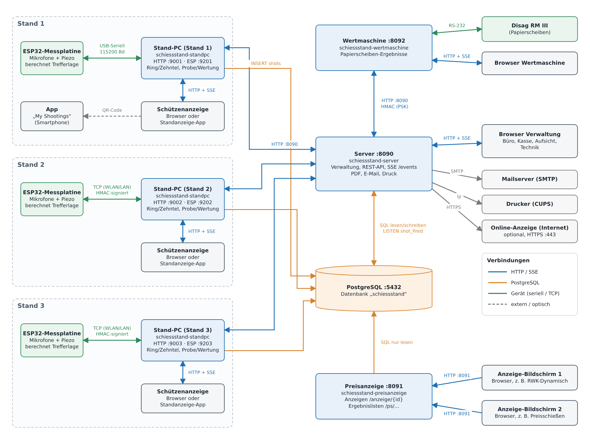

# 10. Kommunikation der Komponenten

Dieses Kapitel beschreibt, welche Programme der Anlage miteinander
sprechen, über welchen Weg, wer eine Aktion auslöst und welche Daten
dabei fließen. Grundlage ist der Programmcode (Stand Oktober 2026,
Migration 087).

*Das Bild gibt es auch als bearbeitbare draw.io-Datei:
[kommunikation.drawio](kommunikation.drawio). Beide werden mit
`docs/tools/kommunikation_diagramm.py` erzeugt.*

## Komponenten und Ports

| Komponente | Dienst (systemd) | Läuft auf | Netzwerk |
|---|---|---|---|
| **PostgreSQL** | `postgresql` | Server-Rechner | TCP 5432 |
| **Server** | `schiessstand-server` | Server-Rechner | HTTP 8090 |
| **Stand-PC** (einer je Stand) | `schiessstand-standpc`, `schiessstand-standpc-laneNN` | Stand-PC oder Server-Rechner | HTTP `http_listen` (z. B. 9001), ESP-Verbindung `tcp_listen` (z. B. 9201) |
| **ESP32-Messplatine** (eine je Stand) | Firmware | im Kugelfang | USB-Seriell oder TCP-Client zum Stand-PC |
| **Preisanzeige** | `schiessstand-preisanzeige` | Server-Rechner (oder ein anderer Rechner mit Datenbankzugang) | HTTP 8091 |
| **Wertmaschine** | `schiessstand-wertmaschine` | Rechner an der Disag-Maschine | HTTP 8092, RS-232 zur Maschine |
| **Browser** | – | beliebige Geräte im Netz | greifen per HTTP auf die Dienste oben zu |
| **Standanzeige-App** | Android-App | Tablet am Stand | wie ein Browser zum Stand-PC |
| **App „My Shootings“** | Android-App | Smartphone des Schützen | **keine** Netzverbindung zur Anlage, nur QR-Code |
| **Mailserver, Drucker** | extern | – | SMTP, CUPS (`lp`) |
| **Online-Anzeige** (optional) | `schiessstand-online` | Server im Internet, eigene Datenbank | HTTPS (443); siehe [Kapitel 11](11-online.md) |

Die Ports der Stand-PCs stehen in deren Konfigurationsdatei
(`config.json` bzw. `config-laneNN.json`). Mehrere Stand-PC-Instanzen
können auf einem Rechner laufen, jede mit eigenen Ports.

## Wer greift direkt auf die Datenbank zu?

| Komponente | Zugriff | Was |
|---|---|---|
| **Server** | lesen und schreiben | alle Tabellen; legt das Schema an (Migrationen), dauerhafte `LISTEN shot_fired`-Verbindung; Sicherung/Wiederherstellung mit `pg_dump`/`pg_restore` |
| **Stand-PC** | **nur schreiben, nur Schüsse** | `INSERT INTO shots …` (mit `ON CONFLICT DO NOTHING`); alles andere holt er über die REST-API des Servers |
| **Preisanzeige** | **nur lesen** | Anzeige-Konfiguration (`anzeige_config`, `ps_anzeige_config`), vorberechnete Preisschießen-Wertungen (`ps_wertung_ergebnisse`), für die Live-Anzeigen auch Stände, Sitzungen, Schüsse, Starter und Wettkämpfe |
| **Wertmaschine** | keiner | spricht nur mit der REST-API des Servers |
| **Online-Anzeige** | nur eigene Datenbank | kein Zugriff auf die Datenbank der Anlage; erhält Momentaufnahmen vom Server |
| Browser, Apps, ESP32 | keiner | – |

In der Datenbank arbeiten Trigger auf der Tabelle `shots`:

- `trg_shots_notify` sendet bei jedem neuen Schuss eine Benachrichtigung
  `pg_notify('shot_fired', …)` mit Sitzung, Schussnummer, Lage, Ring und
  Zehntel. Darüber erfährt der Server von Schüssen, die der Stand-PC direkt
  geschrieben hat.
- weitere Trigger setzen den Beginn der Sitzung und den Wechsel in die
  Wertung (`started_at`, `match_started_at`) und verhindern das Löschen von
  Schüssen.

Die Preisschießen-Wertungen rechnet der Server regelmäßig vor und legt sie
in `ps_wertung_ergebnisse` ab. Die Preisanzeige liest sie nur, damit viele
Bildschirme den Server nicht belasten.

## Ein Schießstand im Detail

### ESP32 ↔ Stand-PC

| | |
|---|---|
| **Weg** | **USB-Seriell** (115200 Baud) oder **TCP** über WLAN/LAN. Bei TCP verbindet sich der ESP32 als Client zum Stand-PC (`tcp_listen`); die Zieladresse wird am ESP32 mit `SET HOST`/`SET PORT` eingestellt. Der Stand-PC hält genau eine Geräteverbindung. |
| **Format** | ein Text-Zeilenstrom: ESP32 → Stand-PC je Zeile ein JSON-Telegramm, Stand-PC → ESP32 Befehlszeilen (`SET …`, `SHOW`, `CAL …`, `STATUS`, …). Mit einem Suffix `#<id>` tragen die Antworten die Kennung `"corr"`, so ordnet der Stand-PC sie dem Befehl zu. |
| **Absicherung** | Ist ein anlagenweiter Schlüssel (`esp32_psk_hex`) eingerichtet, trägt jede TCP-Zeile in beide Richtungen eine HMAC-SHA256-Signatur (64 Bit). Die serielle Verbindung ist unsigniert (Kabelzugang ist die Absicherung). |
| **ESP32 → Stand-PC** | `shot` (Trefferlage `x_um`/`y_um`, Laufzeiten `air_ns`, Qualitätswerte, Zone), `reject` (verworfene Auslösung), `raw` (Rohdaten für den Simulator, nur mit `SET RAWLOG=1`), `status`, `config`, `confignet`, `zones`, `cal` (Kalibrierfortschritt), `ok`/`error`/`pong`/`ready` |
| **Stand-PC → ESP32** | Konfiguration (`SET <KEY>=<Wert>`, z. B. Lochradius `SET ZHOLE` je Scheibe, `SET RAWLOG` bei Wartungsbelegung), Abfragen (`SHOW`, `SHOWZONES`, `SHOWNET`, `STATUS`), Kalibrierung (`CAL START`, `CAL IMPORT`, `CAL STATUS`) |

Die Messplatine **berechnet die Trefferlage selbst**. Der Stand-PC rechnet
daraus nur Ring, Zehntel und Teiler und zählt Probe- und Wertungsschüsse.
Die vollständige Befehls- und Telegrammreferenz steht in
`standpc/firmware/protokoll-referenz.md`.

### Stand-PC → Server (REST-API, Port 8090)

Der Stand-PC fragt den Server regelmäßig ab (**Poll alle 3 Sekunden**) und
meldet seinen Zustand. Der Server muss den Stand-PC dafür nicht kennen.

| Aufruf | Wann | Daten |
|---|---|---|
| `GET /api/lanes/{n}/session` | alle 3 s | aktive Sitzung des Stands: Schütze, Disziplin mit Schusszahlen und Wertungsart, Kalibrierung, Zählerstände, Modus (Wertung durch die Standsteuerung), Schießzeit, Stechschuss; leer = Stand frei |
| `GET /api/lanes/{n}/ui-lock` | alle 3 s | Bedienung gesperrt ja/nein |
| `GET /api/lanes/{n}/preisschiessen` | alle 3 s | Preisschießen am Stand: Teilnehmer, Guthaben, Scheibenauswahl, Angebot |
| `GET /api/settings/standpc-dev-mode` | alle 3 s | Entwicklermodus (Schuss per Mausklick) |
| `PUT /api/lanes/{n}/livestate` | alle 3 s und bei jeder Änderung | Modus, Anzahl und Summe der Wertungsschüsse, eigene Adresse (Anmeldung beim Server, siehe unten) |
| `GET /api/sessions/{id}/shots` | bei Übernahme einer Sitzung mit vorhandenen Schüssen (z. B. Standwechsel) | Schussliste zum Wiederherstellen der Anzeige |
| `POST /api/sessions/{id}/status` | „Stand freigeben“ am Stand | Sitzung beenden |
| `POST /api/lanes/{n}/preisschiessen/…` | Aktion des Schützen im Preisschießen-Menü | wird unverändert weitergereicht (Scheibe wählen, buchen, freigeben, Teilnehmer wählen, …) |
| `/api/lanes/{n}/ergebnis-ausgabe/…` | „Ergebnis mitnehmen“ | wird weitergereicht; der Server erzeugt PDF, versendet die E-Mail, druckt oder liefert den QR-Code |
| `POST /api/esp32-config`, `POST /api/esp32-calibrations` | nach Änderungen an der Messplatine und regelmäßig | Sicherung der kompletten Platinen-Konfiguration bzw. Kalibrierung (je MAC-Adresse) |
| `GET /api/lanes/{n}/calibration-transfer`, `…/simulator-configs`, `POST …/calibration-transfer/from-config`, `POST …/calibration-transfer/applied` | Admin-Oberfläche am Stand | im Simulator freigegebene Kalibrierung holen, prüfen, aufspielen und das Ergebnis zurückmelden |

**Anmeldung beim Server:** Mit dem Live-Status schickt jeder Stand-PC seine
eigene Adresse (z. B. `http://192.168.2.174:9004`). Der Server speichert
sie als Stand-PC-Adresse des Stands (`lanes.standpc_url`, sichtbar in den
[Einstellungen](08-verwaltung.md#einstellungen)) und nutzt sie für die
wenigen Aufrufe in Gegenrichtung.

### Server → Stand-PC

Nur wenige Funktionen gehen vom Server zum Stand-PC (an die gemeldete
Adresse):

| Aufruf am Stand-PC | Ausgelöst durch | Daten |
|---|---|---|
| `PUT /api/font-sizes` | Einstellungen → Schriftgrößen „an alle Stände senden“ | Schriftgrößen der Anzeige |
| `PUT /api/admin-password-hash` | Einstellungen → Admin-Passwort | Passwort-Hash der Admin-Oberfläche |
| `PUT /api/disciplines/config` | Standaktion → Disziplinen übertragen | Disziplinliste für den Betrieb ohne Server |
| `GET /api/local-sessions`, `…/{id}/shots` | Standaktion → Schüsse aus lokalem Log importieren | lokal protokollierte Sitzungen und Schüsse |

### Stand-PC → Datenbank

Jeder Schuss wird zuerst in das **lokale Schussprotokoll** des Stand-PC
geschrieben (eine JSON-Zeile je Schuss, eine Datei je Stand und Tag) und
dann über eine Warteschlange in die Tabelle `shots` eingetragen. Ist die
Datenbank nicht erreichbar, wiederholt der Stand-PC das mit wachsendem
Abstand. Nach einem Neustart reiht er alle Schüsse des laufenden Tages aus
dem lokalen Protokoll erneut ein; bereits gespeicherte Schüsse werden dabei
übersprungen. Schüsse zu einer inzwischen gelöschten Sitzung verwirft er.

### Stand-PC ↔ Schützenanzeige (Browser oder App)

Die Anzeige am Stand ist eine Webseite des Stand-PC (`http_listen`). Der
Browser bzw. die Standanzeige-App

- lädt die Seite und die Grunddaten (`/status`, `/shots`, `/targets`,
  `/disciplines`, `/font-sizes`, `/preisschiessen`),
- hält eine **SSE-Verbindung** `/events`, über die der Stand-PC sofort
  `shot` (neuer Schuss), `status` (Modus, Disziplin, Schütze, Schießzeit,
  Sperre, Stechschuss), `preisschiessen` und `fontsizes` schickt,
- sendet Bedienaktionen als `POST`: `/mode` (Probe/Wertung), `/freigeben`,
  `/discipline`, `/preisschiessen/…`, `/ergebnis/…`. Bei gesperrter
  Bedienung lehnt der Stand-PC sie ab.

Unter `/admin` liegt die passwortgeschützte Admin-Oberfläche des Stand-PC.

### Ablauf eines Schusses

1. Die Messplatine erkennt den Schuss, berechnet die Trefferlage und
   schickt ein `shot`-Telegramm an den Stand-PC.
2. Der Stand-PC prüft Zeit-, Umschalt- und Sperrregeln, berechnet Ring,
   Zehntel und Teiler und vergibt Schuss- und Seriennummer.
3. Er schreibt den Schuss in das lokale Protokoll und reiht ihn für die
   Datenbank ein.
4. Er schickt den Schuss per SSE an die Schützenanzeige – unabhängig davon,
   ob Server und Datenbank erreichbar sind.
5. Er meldet den neuen Stand (Schusszahl, Summe) per Live-Status an den
   Server.
6. Der Eintrag in `shots` löst `pg_notify` aus; der Server verteilt den
   Schuss per SSE (`/events`) an alle offenen Standsteuerungen.
7. Die Anzeige-Bildschirme der Preisanzeige zeigen ihn beim nächsten Abruf
   (alle 3 Sekunden).

## Wie werden Aktionen ausgelöst?

Grundprinzip: **Der Server legt den Sollzustand in der Datenbank ab, der
Stand-PC holt ihn ab.** Eine Aktion in der Standsteuerung wirkt deshalb am
Stand nach höchstens 3 Sekunden. Aktionen am Stand schickt der Stand-PC
sofort an den Server.

| Aktion | Auslöser | Weg |
|---|---|---|
| Stand belegen | Standsteuerung, Wettkampf-Schnellbelegung | Server legt Sitzung an → Stand-PC übernimmt sie beim nächsten Poll (Schütze, Disziplin, Kalibrierung) |
| Probe/Wertung zentral, Zeit starten | Standsteuerung | Sitzungsstatus bzw. Startzeit in der Datenbank → Poll |
| Bedienung sperren | Standsteuerung | `lanes.ui_locked` → Poll `ui-lock` |
| Stechschuss | Standsteuerung | Server beendet die Sitzungen und legt je Stand eine Stechschuss-Sitzung an → Poll |
| Stand freigeben | Standsteuerung | Sitzung beendet → Poll liefert „frei“ |
| Stand freigeben | Schütze am Stand (🚪) | Stand-PC → `POST /api/sessions/{id}/status` |
| Probe/Wertung umschalten | Schütze am Stand | bleibt im Stand-PC; der Server sieht es im Live-Status und an der Art der Schüsse |
| Preisschießen: Scheibe wählen, buchen … | Teilnehmer am Stand | Stand-PC reicht weiter, fragt danach sofort neu ab |
| Ergebnis mitnehmen | Schütze am Stand | Stand-PC reicht weiter; Server sendet E-Mail (SMTP) bzw. druckt (CUPS) |
| Kalibrierung übernehmen | Simulator (Freigabe) und Admin am Stand-PC | Server speichert die Freigabe → Admin-Oberfläche holt sie ab → Stand-PC schreibt sie per `SET`/`CAL IMPORT` auf die Messplatine → meldet das Ergebnis zurück |
| Schriftgrößen, Admin-Passwort, Disziplinen | Einstellungen, Standaktion | Server ruft den Stand-PC direkt auf |
| Live-Übersicht in der Standsteuerung | neuer Schuss in der Datenbank | Trigger → `pg_notify` → Server → SSE an den Browser; zusätzlich Abruf alle 10 s |
| Anzeige-Bildschirm umstellen | Seite „Anzeigen“ | Server schreibt `anzeige_config` → Preisanzeige liest sie bei jedem Abruf |
| Papierscheibe auswerten | Browser der Wertmaschine | Wertmaschine steuert die Disag per RS-232 und schickt die Ergebnisse an den Server |

## Welche Daten fließen?

| Verbindung | Richtung | Inhalt |
|---|---|---|
| ESP32 → Stand-PC | Messdaten | Trefferlage, Laufzeiten je Mikrofon, Qualitätswerte, Zone, ggf. Rohflanken; Status und Konfiguration der Platine |
| Stand-PC → ESP32 | Befehle | Parameter, Kalibrierwerte, Abfragen |
| Stand-PC → Datenbank | Schüsse | je Schuss Lage, Ring, Zehntel, Teiler, Art (Probe/Wertung), Status, Serie sowie alle Rohdaten für den Simulator |
| Server → Stand-PC (Poll-Antwort) | Sollzustand | Belegung, Disziplin, Kalibrierung, Schießzeit, Sperre, Preisschießen-Daten |
| Stand-PC → Server | Zustand und Weiterleitungen | Live-Status, Konfigurations- und Kalibrier-Sicherungen, Aktionen des Schützen |
| Server ↔ Browser | Verwaltung | Seiten, REST-API (JSON), Live-Schüsse per SSE, PDFs |
| Preisanzeige → Browser | Anzeigen | fertige HTML-Seiten, bei Live-Anzeigen alle 3 s neue Inhalte (`?partial=1`) |
| Wertmaschine → Server | Papierscheiben | Seriennummer der Scheibe, Schüsse mit Ring/Zehntel/Teiler; Abfrage von Konfiguration und Preisschießen |
| Schützenanzeige → App „My Shootings“ | QR-Code (optisch) | bis zu 60 Schüsse mit Lage, Zehntel und Kopfdaten |
| Server → Mailserver / Drucker | Ergebnisausgabe | Einzelergebnis als PDF |
| Server → Online-Anzeige | Veröffentlichungen | Momentaufnahmen von Preisschießen (Ergebnislisten) und Rundenwettkämpfen (Starter, Ergebnisse, Treffer), siehe [Kapitel 11](11-online.md#was-wird-übertragen) |

## Anmeldung und Absicherung

| Verbindung | Absicherung |
|---|---|
| Browser → Server | Rolle per Cookie (`ss_role`), optional mit Passwort; Seiten sind je Rolle freigegeben, einzelne Aktionen verlangen Admin- bzw. Sonderrechte. Rollen mit Passwort enden nach 1 Stunde ohne Nutzung. |
| Stand-PC → Server | keine Anmeldung (vertrauenswürdiges Netz der Anlage) |
| Wertmaschine → Server | HMAC-Signatur je Anfrage (Kopfzeile `X-Wertmaschine-Auth`, gemeinsamer Schlüssel) |
| ESP32 ↔ Stand-PC (TCP) | HMAC-Signatur je Zeile, sobald ein Schlüssel eingerichtet ist |
| Browser → Stand-PC-Admin | Passwort (Hash wird vom Server verteilt) |
| Server, Stand-PC, Preisanzeige → Datenbank | Benutzer und Passwort der Datenbank aus der jeweiligen Konfiguration (`/etc/schiessstand/…`, `config.json`) |
| Browser → Preisanzeige | keine (nur lesende, öffentliche Anzeigen) |
| Server → Online-Anzeige | HTTPS mit Zertifikatsprüfung, API-Schlüssel des Vereins (`Authorization: Bearer ssk_…`) |

### Server → Online-Anzeige (Internet)

Optional überträgt der Server ausgewählte Preisschießen und
Rundenwettkämpfe an einen Online-Server im Internet: per
`PUT https://<online-server>/api/v1/publish/<art>/<id>` im eingestellten
Takt (Rundenwettkampf 3–5 s, Preisschießen 1–5 min), nur bei Änderungen.
Die Verbindung geht immer vom Server aus; der Online-Server baut keine
Verbindung zur Anlage auf. Details: [Kapitel 11](11-online.md).

## Verhalten bei Störungen

- **Server oder Netz fällt aus:** Der Stand schießt weiter. Treffer
  erscheinen sofort auf der Schützenanzeige, das lokale Protokoll läuft
  weiter, die Datenbank-Einträge werden nachgeholt. Neue Belegungen und
  Aktionen der Standsteuerung kommen erst wieder an, wenn der Server
  erreichbar ist.
- **Stand-PC startet neu:** Er übernimmt Sitzung und Zählerstände vom
  Server, stellt die Trefferliste aus dem lokalen Protokoll bzw. vom Server
  wieder her und schreibt fehlende Schüsse des Tages nach.
- **Messplatine verliert die Verbindung:** Bei TCP verbindet sie sich neu,
  der Stand-PC ersetzt die alte Verbindung.
- **Preisanzeige ausgefallen:** betrifft nur die Bildschirme; Server und
  Stände arbeiten unabhängig davon.
